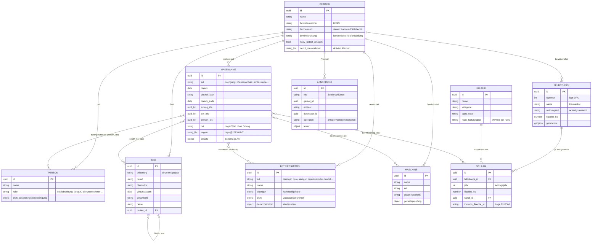
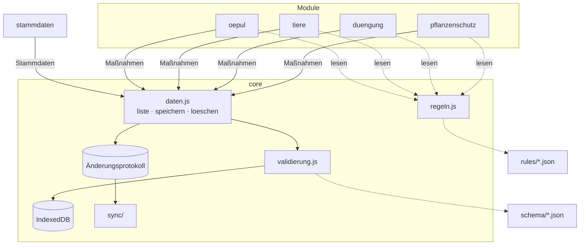
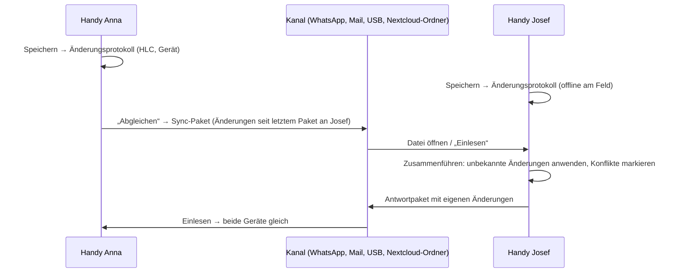

# Architektur – AGRARDOK+

Stand: 11.11.2026 · Status: **Entwurf v0.1** (Schema-Version `0.1`)

Dieses Dokument beschreibt:
1. das gemeinsame Datenmodell, also welche Daten es gibt und wie sie zusammenhängen (Diagramm und JSON-Schemas unter [`/schema`](../schema)),
2. die Ordnerstruktur und wie Module zusammenspielen,
3. wie mehrere Geräte und Personen später Daten abgleichen können, ohne dass ein teurer Server nötig ist. Drei Varianten sind bewertet, mit Empfehlung.

Grundlage sind die Leitplanken in [CLAUDE.md](../CLAUDE.md) und die Pflichtfelder aus [rechtsgrundlagen.md](rechtsgrundlagen.md).

---

## 1. Leitideen

| Idee | Bedeutung | Warum |
|---|---|---|
| **Alles, was passiert, ist eine Maßnahme** | Düngung, Spritzung, Ernte, Weide, Behandlung, Geburt, Zukauf … sind Datensätze einer Entität `massnahme` mit gemeinsamen Feldern und artspezifischen `details` | Ein Modell für alle Module; Auswertungen über Modulgrenzen hinweg (z. B. „alles auf Schlag X“) sind trivial |
| **Stammdaten gehören allen, Maßnahmen dem Modul** | Betrieb, Feldstück, Schlag, Kultur, Tier, Betriebsmittel, Maschine, Person werden zentral gepflegt; jedes Modul legt nur Maßnahmen seiner Arten an | Module bleiben unabhängig, aber niemand pflegt Schläge doppelt |
| **Momentaufnahme statt nur Verweis** | Rechtlich relevante Angaben (PSM-Name und Zulassungsnummer, Kulturname, Flächeneinheit) werden beim Speichern in die Maßnahme **kopiert** | Eine Aufzeichnung von 2026 muss 2033 noch stimmen, auch wenn das Betriebsmittel inzwischen umbenannt wurde |
| **Bestand wird berechnet, nicht gespeichert** | Tierbestand, N-Bilanz, Wartezeit-Status sind Auswertungen über Maßnahmen | Keine widersprüchlichen Zwischenstände; synchronisationsfreundlich |
| **Synchronisationsfähig ab Tag 1** | Jeder Datensatz hat UUID, `rev`, `hlc`, `geraet_id` und eine Löschmarke; jede Speicherung schreibt einen Eintrag ins Änderungsprotokoll | Spätere Synchronisation braucht keine Datenmigration |
| **Regeln sind Daten** | Grenzwerte, Fristen und Faktoren kommen aus `/rules` (mit `quelle`, `gueltig_ab`, `gueltig_bis`); die Maßnahme merkt sich, welche Regelversion sie verwendet hat (`regeln`) | Rechtsänderungen ohne Code-Änderung; Berechnungen bleiben nachvollziehbar |

---

## 2. Datenmodell

### 2.1 Übersicht (Entitäten und Beziehungen)



**Felder, die jeder Datensatz hat** (`common.schema.json#/$defs/basis`): `id`, `betrieb_id`, `erstellt_am`, `erstellt_von`, `geaendert_am`, `geaendert_von`, `geraet_id`, `hlc`, `rev`, `geloescht`, `notiz`.

### 2.2 Maßnahmenarten und wo ihre Pflichtfelder herkommen

| `art` | Detail-Schema | Rechtlicher Hintergrund (siehe rechtsgrundlagen.md) | Bezug |
|---|---|---|---|
| `duengung` | [duengung](../schema/massnahmen/duengung.schema.json) | NAPV § 8, § 9 | Schlag |
| `pflanzenschutz` | [pflanzenschutz](../schema/massnahmen/pflanzenschutz.schema.json) | Art. 67 VO 1107/2009, Anhang DVO 2023/564, Landesgesetze | Schlag oder Ort |
| `aussaat` | [aussaat](../schema/massnahmen/aussaat.schema.json) | NAPV § 9 (Anbaudatum), ÖPUL Immergrün | Schlag |
| `ernte` | [ernte](../schema/massnahmen/ernte.schema.json) | NAPV § 8 Z 6, § 9 Z 4–5 | Schlag |
| `bodenbearbeitung` | [bodenbearbeitung](../schema/massnahmen/bodenbearbeitung.schema.json) | NAPV § 8 Z 7, ÖPUL Immergrün (Umbruch) | Schlag |
| `bewaesserung` | [bewaesserung](../schema/massnahmen/bewaesserung.schema.json) | NAPV § 8 Z 4, § 9 Z 3 | Schlag |
| `weide` | [weide](../schema/massnahmen/weide.schema.json) | ÖPUL Tierwohl Weide / Naturschutz | Schlag + Tiere |
| `tierbehandlung` | [tierbehandlung](../schema/massnahmen/tierbehandlung.schema.json) | TAMG, Rückstandskontrolle, GAB 6 | Tier |
| `tierbewegung` | [tierbewegung](../schema/massnahmen/tierbewegung.schema.json) | § 5/§ 7 RKZV 2021, § 19 TKZVO | Tier |
| `biozid` | [biozid](../schema/massnahmen/biozid.schema.json) | GAB 5 (Lebensmittelsicherheit) | Ort |
| `feldmiete` | [feldmiete](../schema/massnahmen/feldmiete.schema.json) | NAPV § 9 Abs. 7 | Schlag |
| `pflege` | [pflege](../schema/massnahmen/pflege.schema.json) | ÖPUL Begrünung (Häckseln/Mähen), Schlagkartei | Schlag |
| `sonstiges` | (frei) | – | beliebig |

**Weitere Entitäten seit 0.5** (eigene Stores, Migration 2):

| Entität | Schema | Wofür |
|---|---|---|
| `duengeplan` | [duengeplan](../schema/duengeplan.schema.json) | Düngeplanung je Schlag und Jahr (NAPV Anlage 3, P/K-Empfehlung) als Momentaufnahme mit Regelversion |
| `bodenprobe` | [bodenprobe](../schema/bodenprobe.schema.json) | Bodenuntersuchung je Feldstück mit Gehaltsklassen |
| `feldnotiz` | [feldnotiz](../schema/feldnotiz.schema.json) | Beobachtung mit GPS-Position, Schlag und Fotos |
| `anhang` | [anhang](../schema/anhang.schema.json) | Foto/Beleg als Data-URL (offline verfügbar, im JSON-Export enthalten) |

Maßnahmen haben seit 0.5 das Feld `bestaetigungen`: die Codes der Warnungen, die bei der Erfassung ausdrücklich bestätigt wurden (z. B. `napv_bodenzustand`). So ist nachvollziehbar, was geprüft wurde.

### 2.3 Bewusste Modellentscheidungen

- **Feldstück und Schlag getrennt, Schlag je Jahr:** Das entspricht dem Mehrfachantrag. Feldstücke bleiben über Jahre bestehen, Schläge werden jedes Jahr neu angelegt (Vorjahr kopieren). Fruchtfolge = Schläge eines Feldstücks über die Jahre.
- **Kultur als Katalog:** Ein mitgelieferter globaler Katalog (ohne `betrieb_id`) plus eigene Einträge. EPPO-Code und NAPV-Kulturgruppe hängen an der Kultur, nicht an jeder Maßnahme.
- **Tiere als Einzeltier oder Gruppe:** Rinder werden einzeln geführt (Ohrmarke Pflicht laut Schema). Schweine meist als Gruppe mit Stückzahl in der `tierbewegung`. Das Bestandsverzeichnis ist eine Auswertung über `tierbewegung`-Maßnahmen.
- **Mehrere Betriebe in einer Datenbank** sind über `betrieb_id` möglich, z. B. für Lohnunternehmer oder für Beratung.
- **Fiktive Schema-Domain:** Die `$id`-Adressen nutzen `https://agrardok.invalid/schema/`. Die Endung `.invalid` ist reserviert und kann nie echt werden. Sobald die Seite auf GitHub Pages läuft, ersetzen wir sie durch die echte Adresse.

### 2.4 Schemas, Testdaten, Prüfung

```
schema/
├── common.schema.json          gemeinsame Bausteine (uuid, datum, menge, basis …)
├── betrieb | person | feldstueck | schlag | kultur | tier | betriebsmittel | maschine .schema.json
├── duengeplan | bodenprobe | feldnotiz | anhang .schema.json   (seit 0.5)
├── massnahme.schema.json       Basis + Auswahl des Detail-Schemas über if/then
├── massnahmen/*.schema.json    ein Detail-Schema je Maßnahmenart
├── aenderung.schema.json       Eintrag im Änderungsprotokoll (Sync)
└── export.schema.json          Austauschformat (Sicherung, Gerätewechsel, Sync-Paket)
```

- Testdaten: [testdaten/musterbetrieb.json](../testdaten/musterbetrieb.json) mit dem fiktiven „Musterhof Lindenau“: 18,2 ha (also NAPV-aufzeichnungspflichtig), 4 Feldstücke, Rinder und Mastschweine, 12 Maßnahmen von Aussaat bis Biozid. Alle Namen, Nummern, Mittel und Koordinaten sind erfunden.
- Prüfung: `python3 werkzeuge/pruefe_daten.py testdaten/musterbetrieb.json`. Das Werkzeug prüft gegen die Schemas **und** ob alle Verweise (`schlag_ids`, `kultur_id` …) existieren. Es braucht `pip install "jsonschema>=4.18"` und ist nur für die Entwicklung gedacht; die App braucht es nicht.

---

## 3. Ordnerstruktur und Module

### 3.1 Struktur

```
AgrarOPEN/
├── index.html               App-Hülle: Startseite, Navigation, lädt aktive Module
├── manifest.webmanifest     PWA-Manifest (Installieren auf dem Handy)
├── sw.js                    Service Worker: legt alle Dateien offline ab
├── core/                    Gemeinsamer Kern – Datenzugriff und Bausteine, die mehrere Module brauchen
│   ├── betrieb.js | bestand.js   aktiver Betrieb; Schläge mit Kultur/Feldstück, Maßnahmen lesen (nur lesen)
│   ├── oepul.js | psm.js | person.js | boden.js   von mehreren Modulen genutzte Fachfunktionen
│   ├── fristen.js | startkarten.js   Registries: Module melden Fristen bzw. Startseiten-Karten an
│   ├── daten.js             Lesen/Speichern in IndexedDB, schreibt Änderungsprotokoll
│   ├── ids.js               UUID- und HLC-Erzeugung
│   ├── validierung.js       Prüfung gegen /schema vor jedem Speichern
│   ├── regeln.js            Lädt /rules und wählt die am Stichtag gültige Version
│   ├── export/              JSON (export.schema), CSV je Maßnahmenart, GeoJSON
│   ├── sync/                Zusammenführen + Transport-Adapter (zuerst: datei.js)
│   └── ui/                  Bausteine: große Buttons, Listen, Formulare, Datumsauswahl
├── stammdaten/              Betrieb, Personen (Sachkunde), Maschinen (Geräteprüfung)
├── flaechen/                Feldstücke, Schläge, Kulturkatalog, Karte, eAMA-Import
├── betriebsmittel/          Dünger, PSM, Saatgut, Tierarzneimittel
├── schlagkartei/            Aufzeichnen-Einstieg, Bodenbearbeitung, Aussaat, Pflege, Ernte, Bewässerung,
│                            Zeitachse je Schlag, Jahresübersicht je Kultur
├── duengung/                NAPV: Erfassung mit Prüfung (napv.js), Düngeplanung, Jahresbericht
├── pflanzenschutz/          Erfassung mit Prüfung (pruefung.js), Aufzeichnungsliste, CSV-Export
├── oepul/                   Nur gewählte ÖPUL-Maßnahmen, Fristenkalender, Erinnerungen
├── boden/                   Bodenproben, Gehaltsklassen, Karte, CSV-Import
├── feldnotiz/               Feldbegehung mit GPS, Foto, Sprache
│   (je Modul: modul.json, index.js als Einstieg, Fachlogik ohne Oberfläche in eigener Datei mit Unit-Tests)
├── rules/                   Versionierte Rechtsregeln (JSON)
├── schema/                  JSON-Schemas (Abschnitt 2)
├── vendor/                  Wenige eingecheckte Fremdbibliotheken (offline, ohne CDN)
├── testdaten/               Fiktiver Musterbetrieb
├── werkzeuge/               Entwicklerwerkzeuge (nicht Teil der App)
└── docs/
```

Alles ist reines HTML/CSS/JS mit ES-Modulen (`<script type="module">`), ohne Build-Schritt, und läuft direkt auf GitHub Pages.

### 3.2 Modulvertrag

Jedes Modul beschreibt sich in `modul.json`:

```json
{
  "id": "pflanzenschutz",
  "name": "Pflanzenschutz",
  "version": "0.1.0",
  "massnahmen_arten": ["pflanzenschutz"],
  "liest": ["schlag", "kultur", "betriebsmittel", "maschine", "person"],
  "regeln": ["psm"],
  "aktiv_wenn": "immer",
  "einstieg": "index.js"
}
```

`aktiv_wenn` kann z. B. `"tierhaltung"` sein oder `"oepul:Tierwohl_Weide"`. Dann erscheint das Modul nur, wenn der Betrieb es braucht. Weniger Menüpunkte machen die App einfacher.

**Spielregeln:**
1. Ein Modul **schreibt nur Maßnahmen seiner `massnahmen_arten`** und die Entitäten aus `schreibt` in seiner `modul.json`. Stammdaten (Betrieb, Personen, Maschinen) ändert nur `stammdaten`, Flächen nur `flaechen`, Betriebsmittel nur `betriebsmittel`.
2. Module **importieren nie voneinander**, nur aus `core/`. Was mehrere Module brauchen, wandert nach `core/`.
3. Module dürfen **alle Maßnahmen lesen**, z. B. für die Wartezeit-Warnung vor einer Ernte.
4. Neue Felder entstehen **nur über eine Änderung in `/schema`**, mit Erhöhung der `schema_version` und einer Migration in `core/`. So bleibt das Modell gemeinsam.
5. Ein Modul lässt sich entfernen, ohne dass andere brechen. Seine Maßnahmen bleiben gespeichert und erscheinen im Export.



### 3.3 Kern-API (Skizze)

```js
import { daten } from "../../core/daten.js";

const schlaege = await daten.liste("schlag", { jahr: 2026 });
await daten.speichern("massnahme", {
  art: "pflanzenschutz", datum: "2026-04-20", schlag_ids: [schlaege[0].id],
  details: { /* … */ }
}); // ergänzt id, betrieb_id, rev, hlc, geraet_id; validiert; schreibt Änderungsprotokoll
await daten.loeschen("massnahme", id); // setzt nur geloescht = true
```

---

## 4. Synchronisation zwischen Geräten und Personen

### 4.1 Anforderungen
- Mehrere Handys pro Betrieb (Betriebsleitung, Partnerin/Partner, Hofnachfolge), teils ohne Netz am Feld
- Keine laufenden Kosten und kein Server, den jemand betreuen muss
- Daten bleiben beim Betrieb (Datenschutz, Vertrauen)
- Bedienbar ohne IT-Wissen
- Aufzeichnungen müssen bis zu **7 Jahre** sicher erhalten bleiben (NAPV)

> ⚠️ **Wichtig unabhängig von der Variante:** Browser können lokale Daten löschen. Safari auf dem iPhone entfernt Website-Daten nach 7 Tagen ohne Nutzung, wenn die App **nicht** auf dem Home-Bildschirm installiert ist. Deshalb fordern wir `navigator.storage.persist()` an, empfehlen die Installation als App und erinnern regelmäßig an eine Sicherung. **Ohne Sicherung sind 7 Jahre Aufbewahrung nicht garantiert.**

### 4.2 Variante A – IndexedDB + Datei-Export/-Import (mit Änderungsprotokoll)

Die Daten liegen in IndexedDB. Jedes Gerät führt ein Änderungsprotokoll (`aenderung.schema.json`). Für den Abgleich erzeugt ein Gerät ein **Sync-Paket**, das ist eine JSON-Datei nach `export.schema.json` mit den Änderungen seit dem letzten Paket. Es wird über einen beliebigen Kanal verschickt (Teilen-Menü → WhatsApp, Signal, E-Mail, USB-Stick, Nextcloud-Ordner). Das andere Gerät liest es ein und führt die Daten zusammen.

| Vorteile | Nachteile |
|---|---|
| **Null Kosten, null Server, kein Konto** | Abgleich passiert nicht automatisch: Jemand muss „Senden“ und „Einlesen“ tippen |
| Funktioniert sofort und überall offline; passt perfekt zu GitHub Pages | Zusammenführen und Konflikterkennung müssen wir selbst bauen (rund 200–400 Zeilen, gut testbar) |
| Daten verlassen das Gerät nur über Kanäle, die die Nutzer selbst wählen | Bei vielen Geräten wird der manuelle Austausch mühsam (bei 2–3 Handys pro Hof meist unkritisch) |
| Die Sicherungsdatei ist zugleich Umzugs- und Archivformat und ohne App lesbar (JSON/CSV) | |
| Keine Fremdbibliothek, also kleine App und keine Abhängigkeit | |
| Das Protokoll dient zugleich als Nachweis, wer wann was geändert hat | |

### 4.3 Variante B – PouchDB im Browser + CouchDB-Sync

PouchDB speichert die Daten im Browser (über IndexedDB) und gleicht sie automatisch mit einer CouchDB ab, sobald Netz da ist. CouchDB ist dafür gebaut, dass alle Geräte gleichberechtigt Daten ändern und abgleichen.

| Vorteile | Nachteile |
|---|---|
| **Ausgereifte, automatische Synchronisation** im Hintergrund, offline-first by design | **Braucht eine ständig erreichbare CouchDB.** Ein Raspberry Pi am Hof erfordert HTTPS, Portfreigabe und Updates, ein kleiner Mietserver kostet monatlich. In beiden Fällen muss sich jemand kümmern |
| Konflikte werden erkannt und alle Versionen aufbewahrt | Konflikte entstehen **pro Dokument**, nicht pro Feld; die App muss sie trotzdem auflösen |
| Gut dokumentiert, große Gemeinschaft | Zusätzliche, spürbar größere Bibliothek, Bindung an das CouchDB-Protokoll |
| Mehrere Betriebe ließen sich zentral betreuen (z. B. durch einen Verein) | Bei zentralem Betrieb: Verantwortung für fremde Betriebsdaten (DSGVO, Vertrag zur Auftragsverarbeitung) und laufende Kosten |
| | Benutzerkonten und Rechte je Betrieb sind zusätzlicher Aufwand |

### 4.4 Variante C – SQLite im Browser (WASM/OPFS) + Git-Sync

SQLite läuft als WebAssembly im Browser und speichert im Origin Private File System. Der Abgleich erfolgt über ein Git-Repository (z. B. privat auf GitHub/Gitea) mit einer Git-Implementierung im Browser.

| Vorteile | Nachteile |
|---|---|
| Echte SQL-Abfragen, z. B. für NAPV-Bilanz und Auswertungen | **Eine SQLite-Datei lässt sich in Git nicht zusammenführen.** Wir müssten trotzdem jeden Datensatz als JSON-Datei ablegen und selbst zusammenführen, also den Aufwand von A plus Git |
| Lückenlose Versionsgeschichte durch Git | Git im Browser braucht für GitHub einen CORS-Proxy (zusätzlicher Dienst) und **Zugangstokens**, für die Zielgruppe unrealistisch |
| Kostenloses Hosting bei Git-Anbietern | Betriebsdaten in einem Repository bei einem US-Anbieter sind aus Datenschutzsicht heikel |
| | Rund 1 MB WebAssembly zusätzlich; der OPFS-Speicher braucht neuere Browser (ältere Handys sind ein Risiko); manche SQLite-Speichermodi brauchen Server-Header, die GitHub Pages nicht setzen kann |
| | Höchste Komplexität der drei Varianten |

### 4.5 Bewertung

Legende: ++ sehr gut · + gut · o mittel · – schwach · –– ungeeignet

| Kriterium | Gewicht | A: Datei + Protokoll | B: PouchDB/CouchDB | C: SQLite + Git |
|---|---|---|---|---|
| Laufende Kosten | hoch | ++ | – (Server) | + |
| Kein Betreuungsaufwand | hoch | ++ | –– | – |
| Bedienbarkeit für die Zielgruppe | hoch | + (zwei Tipper) | ++ (automatisch), aber Kontoeinrichtung | –– (Tokens) |
| Offline-Fähigkeit | hoch | ++ | ++ | ++ |
| Datenschutz / Datenhoheit | hoch | ++ | o | – |
| Läuft auf alten Handys / GitHub Pages | mittel | ++ | + | – |
| Komfort bei vielen Geräten | mittel | o | ++ | o |
| Entwicklungsaufwand | mittel | + | + | –– |
| Langzeitarchiv (7 Jahre), offenes Format | mittel | ++ | + | + |
| **Gesamt** | | **klar vorne** | gut, wenn jemand den Server betreibt | nicht empfohlen |

### 4.6 Empfehlung: Variante A, in Stufen ausbaubar

**Wir starten mit Variante A** und bauen den Abgleich so, dass der **Transportweg austauschbar** ist:



- **Stufe 1 (MVP):** Vollsicherung als Export und Import (`export.schema.json` mit `daten`), dazu CSV- und GeoJSON-Export. Das Änderungsprotokoll wird von Anfang an mitgeschrieben.
- **Stufe 2:** Sync-Pakete (`export.schema.json` mit `aenderungen`, `seit_hlc`) über das Teilen-Menü (Web Share API), mit Konfliktliste.
- **Stufe 3 (optional, nach Bedarf):** weitere Transport-Adapter in `core/sync/`, ohne Änderung am Datenmodell:
  - **WebDAV-Ordner** (z. B. eine vorhandene Nextcloud oder günstiger Speicher): automatischer Abgleich ohne eigenen Server-Code. ⚠️ Der WebDAV-Server muss CORS erlauben; das ist zu prüfen.
  - **CouchDB** (Variante B), falls eine Organisation (Verein, Maschinenring o. ä.) einen Server betreiben will.

**Wie das Zusammenführen funktioniert** (in `core/sync/`):
1. Jede Änderung hat eine eindeutige `id`. Bereits bekannte Änderungen werden übersprungen, deshalb schadet doppeltes Einlesen nicht.
2. Änderungen werden in **HLC-Reihenfolge** angewendet. Die Hybrid Logical Clock kombiniert Uhrzeit, Zähler und Gerät und ordnet Änderungen auch dann eindeutig, wenn Handy-Uhren leicht falsch gehen.
3. **Pro Feld gewinnt die spätere Änderung.** Weil nur einzelne Felder überschrieben werden, gibt es weniger Konflikte als beim Ersetzen ganzer Datensätze. Ändert Anna das Datum und Josef die Notiz derselben Maßnahme, bleiben beide Änderungen erhalten.
4. **Echte Konflikte** (dasselbe Feld auf zwei Geräten geändert, ohne dass eines die Änderung des anderen kannte) werden trotzdem automatisch entschieden, aber in einer Liste **„Bitte prüfen“** angezeigt. Ändert eine Seite einen Datensatz, den die andere gelöscht hat, gewinnt das Löschen; der Fall erscheint ebenfalls in der Liste.
5. Gelöscht wird nur über die Löschmarke `geloescht`. Das Protokoll wird nie umgeschrieben.
6. Jedes Gerät merkt sich je Partnergerät den zuletzt gesendeten HLC-Stand, damit Pakete klein bleiben.

**Warum nicht gleich Automerge/Yjs (CRDT-Bibliotheken)?** Sie lösen das Zusammenführen elegant, bringen aber eine größere Abhängigkeit und ein Binärformat mit, das sich schlechter als 7-Jahres-Archiv eignet. Unser feldweises Protokoll ist für Formulardaten ausreichend und bleibt lesbares JSON. Sollte es an Grenzen stoßen, lässt sich eine solche Bibliothek später hinter derselben `core/sync`-Schnittstelle einsetzen.

---

## 5. Offene Entscheidungen

| Thema | Optionen | Vorschlag |
|---|---|---|
| JSON-Schema-Prüfung im Browser | ~~eingecheckter Validator (z. B. Ajv)~~ | **Entschieden (v0.2.0):** eigener Validator `core/validierung.js` für den genutzten Teil von JSON Schema 2020-12. Grund: Ajv erzeugt Prüfcode per `new Function`, was unsere Content Security Policy verbietet. Gleichstand mit dem Python-Werkzeug sichern die Browser-Tests (gleiche Fehlerfälle); `werkzeuge/pruefe_app.py` meldet Schema-Schlüsselwörter, die der Validator nicht kennt. |
| Format der Betriebsnummer und der MFA-Schlagnutzungscodes | – | Verifizieren (AMA), dann `pattern`/Katalog schärfen |
| NAPV-Faktoren (jahreswirksames N, Anlage 3–5) | – | Als `/rules/napv/*.json` erfassen; bis dahin berechnet die App `n_jahreswirksam` nicht automatisch |
| Karten-Bibliothek | ~~offen~~ | **Entschieden (v0.3.0):** Leaflet 1.9.4 eingecheckt unter `vendor/` (BSD-2, Prüfsumme in `vendor/README.md`), wird erst bei Bedarf geladen. Läuft unter der CSP ohne Verstoß (automatisch geprüft). Kacheln nur online; der Service Worker speichert fremde Kacheln nicht (OSM-Tile-Policy verbietet Offline-Nutzung). |
| Koordinaten und Shapefile | ~~offen~~ | **Entschieden (v0.3.0):** eigene Module `core/geo/` (ZIP über `DecompressionStream`, Shapefile/DBF, Lambert/Transverse Mercator + Helmert). Geprüft gegen den amtlichen INVEKOS-Dienst und gegen eine unabhängige Python-Umrechnung. |
| Fotos/Belege (`anhang_ids`) | IndexedDB-Blobs / nur Verweis | Blobs in IndexedDB, im Export optional (Dateigröße!) |
| Rechte je Person (z. B. Lohnunternehmer sieht nur eigene Maßnahmen) | – | Erst nach Stufe 2 |
