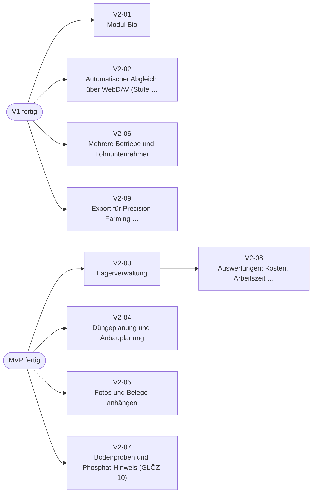

# Roadmap – AGRARDOK+

Stand: 11.11.2026 · Grundlage: [funktionsumfang.md](funktionsumfang.md), [rechtsgrundlagen.md](rechtsgrundlagen.md), [architektur.md](architektur.md)

## So arbeitest du mit dieser Roadmap

- Jede Aufgabe hat eine **ID** (z. B. `MVP-07`), Akzeptanzkriterien und einen **fertigen Prompt**. Den Prompt kannst du mir einzeln geben, z. B. „Setze MVP-07 aus docs/roadmap.md um“. Das reicht, weil alle Details hier stehen.
- Zu jeder Aufgabe gibt es ein **GitHub-Issue-Template** unter [.github/ISSUE_TEMPLATE/](../.github/ISSUE_TEMPLATE/). Auf GitHub erscheinen sie unter *New issue* in der Auswahl, sortiert nach ID.
- **Reihenfolge:** Innerhalb eines Meilensteins gilt die Spalte „Hängt ab von“. Die Rechercheaufgaben (MVP-11, MVP-12) können parallel zum Kern laufen.
- **Pflege:** Aufgaben werden **nur** in [werkzeuge/roadmap_aufgaben.json](../werkzeuge/roadmap_aufgaben.json) geändert. Danach erzeugt `python3 werkzeuge/erzeuge_roadmap.py` die Templates und den Aufgabenteil dieses Dokuments neu. Den Teil oberhalb der Markierung `AUFGABEN:START` darfst du direkt bearbeiten.

## Meilensteine im Überblick

| Meilenstein | Zielgruppe | Ergebnis | Aufgaben |
|---|---|---|---|
| **MVP** | Ackerbaubetriebe | Dünge- und Pflanzenschutzaufzeichnungen vollständig, offline, exportierbar | 21 |
| **v1** | Gemischte Betriebe mit Rindern/Schweinen, ÖPUL-Teilnehmer | Tierhaltung, ÖPUL, Abgleich mehrerer Handys, Kontrollmappe | 13 |
| **v2** | Alle | Komfort: Bio, Lager, Planung, Belege, automatischer Abgleich, Auswertungen | 9 |

## Was das MVP vollständig abdecken muss

Das MVP ist fertig, wenn ein Ackerbaubetrieb **jede** der folgenden Pflichten mit der App erfüllen kann. Die Zuordnung zu den Aufgaben zeigt, dass nichts fehlt.

| Pflicht (siehe rechtsgrundlagen.md) | Was die App können muss | Aufgaben |
|---|---|---|
| NAPV § 8 Abs. 1 Z 1: LN und gedüngte LN | Feldstücke, Schläge, Flächen je Jahr | MVP-09 |
| NAPV § 8 Abs. 1 Z 2: Wirtschaftsdünger (Übernahme/Abgabe) | Übernahme mit Düngerabgabevertrag; *Anfall aus eigenem Tierbestand erst v1* | MVP-10, MVP-15 (V1-06) |
| NAPV § 8 Abs. 1 Z 3: jahreswirksames N aus allen Düngern | Düngung erfassen, N automatisch berechnen | MVP-11, MVP-14 |
| NAPV § 8 Abs. 1 Z 4: Bewässerung und N daraus | Bewässerung erfassen | MVP-13 |
| NAPV § 8 Abs. 1 Z 5: N-Bedarf je Kultur und Ertragslage | Kulturkatalog + Regeldatei Anlage 3 | MVP-09, MVP-11 |
| NAPV § 8 Abs. 1 Z 6: Erntemengen mit Beleg | Ernte mit Beleg | MVP-13 |
| NAPV § 8 Abs. 1 Z 7: Bodenbearbeitung zur Vegetationserneuerung | Bodenbearbeitung mit Zweck | MVP-13 |
| NAPV § 8 Abs. 3: bis 31. Jänner, 7 Jahre aufbewahren | Jahresabschluss, Erinnerung, Datensicherung | MVP-07, MVP-15 |
| NAPV § 9 Abs. 6–7 (Anlage-5-Gebiete): Schlagaufzeichnung binnen 14 Tagen, Schlagbilanz, Feldmieten | Schlagbezogene Erfassung, Bilanz, Feldmiete, 14-Tage-Hinweis | MVP-14, MVP-15 |
| PSM Art. 67 + Anhang DVO 2023/564: alle Pflichtfelder | Vollständige PSM-Erfassung inkl. Zulassungsnummer, Fläche, Kultur, BBCH, Uhrzeit | MVP-10, MVP-16 |
| PSM Landesrecht: Eintragsfrist, Zusatzfelder (z. B. Tirol) | Regeln je Bundesland | MVP-12, MVP-16 |
| PSM ab 1.1.2027: elektronisch, maschinenlesbar; mind. 3 Jahre | CSV/JSON-Export, Datensicherung | MVP-07, MVP-17 |
| Sachkunde (Kontrollunterlage) | Ausbildungsbescheinigung bei Personen | MVP-08, MVP-16 |

**Bewusst nicht im MVP**, weil es für einen reinen Ackerbaubetrieb keine Dünge- oder Pflanzenschutzpflicht ist:
- Tierhaltung (Bestandsverzeichnis, Behandlungen) → v1
- ÖPUL-Maßnahmen → v1. Sie sind nur bei Teilnahme Pflicht. Die Basisdaten (Aussaat, Umbruch, Ausbringtechnik) erfasst das MVP aber schon.
- Abgleich mehrerer Geräte → v1. Im MVP reicht die Datensicherung mit Export und Import.
- Flächenimport aus dem Mehrfachantrag → v1. Im MVP werden Flächen von Hand angelegt; mit „Vorjahr übernehmen“ ist das nur einmalig Arbeit.

## Risiken, die die Roadmap beeinflussen

| Risiko | Auswirkung | Gegenmaßnahme |
|---|---|---|
| NAPV-Anlagen (Faktoren, Gebietskulisse) aufwendiger als erwartet | MVP-14/15 rechnen ohne Werte nicht | MVP-11 früh starten; App zeigt fehlende Regelwerte offen an statt zu raten |
| Landes-PSM-Recht uneinheitlich, Lücken bei Bgld/Vbg/Wien | Falsche Fristen | MVP-12; bis dahin gilt die strengste bekannte Frist |
| Datenverlust durch Browser (iOS) | 7 Jahre Aufbewahrung gefährdet | MVP-07 vor allen Fachmodulen fertigstellen |
| Bedienung zu kompliziert für die Zielgruppe | Keine Nutzung | MVP-19, MVP-21; „wie letztes Mal“-Vorlagen in jedem Modul |

<!-- AUFGABEN:START -->
<!-- erzeugt von werkzeuge/erzeuge_roadmap.py – nicht von Hand bearbeiten -->

## MVP – Dünge- und Pflanzenschutzaufzeichnungen für Ackerbaubetriebe

**Ziel:** Ein Ackerbaubetrieb führt seine Aufzeichnungen nach NAPV (§ 8, bei Anlage-5-Gebieten auch § 9) und nach Pflanzenschutzrecht (Art. 67 VO 1107/2009, Anhang DVO 2023/564, Landesrecht) vollständig, offline am Handy, mit maschinenlesbarem Export und Datensicherung.

| ID | Aufgabe | Bereich | Hängt ab von | Stand |
|---|---|---|---|---|
| [MVP-01](#mvp-01--app-grundgerüst-als-pwa) | App-Grundgerüst als PWA | core | – | ✅ erledigt (0.1.0) |
| [MVP-02](#mvp-02--testumgebung-ohne-build) | Testumgebung ohne Build | core | MVP-01 | ✅ erledigt (0.1.0) |
| [MVP-03](#mvp-03--ids-und-hybrid-logical-clock-coreidsjs) | IDs und Hybrid Logical Clock (core/ids.js) | core | MVP-02 | ✅ erledigt (0.1.0) |
| [MVP-04](#mvp-04--datenspeicher-mit-änderungsprotokoll-coredatenjs) | Datenspeicher mit Änderungsprotokoll (core/daten.js) | core | MVP-03 | ✅ erledigt (0.1.0) |
| [MVP-05](#mvp-05--validierung-im-browser-corevalidierungjs) | Validierung im Browser (core/validierung.js) | core | MVP-04 | ✅ erledigt (0.2.0) |
| [MVP-06](#mvp-06--regel-format-und-regel-lader-coreregelnjs) | Regel-Format und Regel-Lader (core/regeln.js) | rules | MVP-05 | 🟡 teilweise (0.1.0) |
| [MVP-07](#mvp-07--datensicherung-export-und-import) | Datensicherung, Export und Import | core | MVP-05 | ✅ erledigt (0.1.0) |
| [MVP-08](#mvp-08--ersteinrichtung-betrieb-und-personen) | Ersteinrichtung: Betrieb und Personen | stammdaten | MVP-04, MVP-05 | ✅ erledigt (0.2.0) |
| [MVP-09](#mvp-09--feldstücke-schläge-und-kulturkatalog) | Feldstücke, Schläge und Kulturkatalog | stammdaten | MVP-06, MVP-08 | ✅ erledigt (0.3.0) |
| [MVP-10](#mvp-10--betriebsmittel-dünger-und-pflanzenschutzmittel) | Betriebsmittel: Dünger und Pflanzenschutzmittel | stammdaten | MVP-08 | ✅ erledigt (0.4.0) |
| [MVP-11](#mvp-11--regeldateien-napv-recherchieren-und-erfassen) | Regeldateien NAPV recherchieren und erfassen | rules | MVP-06 | 🟡 teilweise (0.5.0) |
| [MVP-12](#mvp-12--regeldateien-pflanzenschutz-je-bundesland) | Regeldateien Pflanzenschutz je Bundesland | rules | MVP-06 | – |
| [MVP-13](#mvp-13--modul-ackerbau-aussaat-ernte-bodenbearbeitung-bewässerung) | Modul Ackerbau: Aussaat, Ernte, Bodenbearbeitung, Bewässerung | modul-ackerbau | MVP-09, MVP-10 | ✅ erledigt (0.5.0) |
| [MVP-14](#mvp-14--modul-düngung-erfassung) | Modul Düngung: Erfassung | modul-duengung | MVP-11, MVP-13 | ✅ erledigt (0.5.0) |
| [MVP-15](#mvp-15--modul-düngung-jahresaufzeichnung--8-und-schlagbilanz--9) | Modul Düngung: Jahresaufzeichnung § 8 und Schlagbilanz § 9 | modul-duengung | MVP-14 | 🟡 teilweise (0.5.0) |
| [MVP-16](#mvp-16--modul-pflanzenschutz-erfassung) | Modul Pflanzenschutz: Erfassung | modul-pflanzenschutz | MVP-10, MVP-12, MVP-13 | ✅ erledigt (0.5.0) |
| [MVP-17](#mvp-17--modul-pflanzenschutz-spritztagebuch-und-maschinenlesbarer-export) | Modul Pflanzenschutz: Spritztagebuch und maschinenlesbarer Export | modul-pflanzenschutz | MVP-16, MVP-07 | ✅ erledigt (0.5.0) |
| [MVP-18](#mvp-18--demo-modus-mit-musterbetrieb) | Demo-Modus mit Musterbetrieb | testdaten | MVP-07, MVP-15, MVP-17 | – |
| [MVP-19](#mvp-19--barrierearmut--und-sonnenlicht-prüfung) | Barrierearmut- und Sonnenlicht-Prüfung | qualitaet | MVP-16, MVP-15 | – |
| [MVP-20](#mvp-20--veröffentlichung-auf-github-pages) | Veröffentlichung auf GitHub Pages | release | MVP-18, MVP-19 | – |
| [MVP-21](#mvp-21--praxistest-mit-testbetrieben) | Praxistest mit Testbetrieben | qualitaet | MVP-20 | – |

```mermaid
flowchart LR
    MVP_01["MVP-01<br/>App-Grundgerüst als PWA"]
    MVP_02["MVP-02<br/>Testumgebung ohne Build"]
    MVP_03["MVP-03<br/>IDs und Hybrid Logical Clock (core/ids.js)"]
    MVP_04["MVP-04<br/>Datenspeicher mit Änderungsprotokoll …"]
    MVP_05["MVP-05<br/>Validierung im Browser …"]
    MVP_06["MVP-06<br/>Regel-Format und Regel-Lader …"]
    MVP_07["MVP-07<br/>Datensicherung, Export und Import"]
    MVP_08["MVP-08<br/>Ersteinrichtung: Betrieb und Personen"]
    MVP_09["MVP-09<br/>Feldstücke, Schläge und Kulturkatalog"]
    MVP_10["MVP-10<br/>Betriebsmittel: Dünger und …"]
    MVP_11["MVP-11<br/>Regeldateien NAPV recherchieren und …"]
    MVP_12["MVP-12<br/>Regeldateien Pflanzenschutz je Bundesland"]
    MVP_13["MVP-13<br/>Modul Ackerbau: Aussaat, Ernte …"]
    MVP_14["MVP-14<br/>Modul Düngung: Erfassung"]
    MVP_15["MVP-15<br/>Modul Düngung: Jahresaufzeichnung § 8 und …"]
    MVP_16["MVP-16<br/>Modul Pflanzenschutz: Erfassung"]
    MVP_17["MVP-17<br/>Modul Pflanzenschutz: Spritztagebuch und …"]
    MVP_18["MVP-18<br/>Demo-Modus mit Musterbetrieb"]
    MVP_19["MVP-19<br/>Barrierearmut- und Sonnenlicht-Prüfung"]
    MVP_20["MVP-20<br/>Veröffentlichung auf GitHub Pages"]
    MVP_21["MVP-21<br/>Praxistest mit Testbetrieben"]
    MVP_01 --> MVP_02
    MVP_02 --> MVP_03
    MVP_03 --> MVP_04
    MVP_04 --> MVP_05
    MVP_05 --> MVP_06
    MVP_05 --> MVP_07
    MVP_04 --> MVP_08
    MVP_05 --> MVP_08
    MVP_06 --> MVP_09
    MVP_08 --> MVP_09
    MVP_08 --> MVP_10
    MVP_06 --> MVP_11
    MVP_06 --> MVP_12
    MVP_09 --> MVP_13
    MVP_10 --> MVP_13
    MVP_11 --> MVP_14
    MVP_13 --> MVP_14
    MVP_14 --> MVP_15
    MVP_10 --> MVP_16
    MVP_12 --> MVP_16
    MVP_13 --> MVP_16
    MVP_16 --> MVP_17
    MVP_07 --> MVP_17
    MVP_07 --> MVP_18
    MVP_15 --> MVP_18
    MVP_17 --> MVP_18
    MVP_16 --> MVP_19
    MVP_15 --> MVP_19
    MVP_18 --> MVP_20
    MVP_19 --> MVP_20
    MVP_20 --> MVP_21
```



### MVP-01 – App-Grundgerüst als PWA

**Ziel:** Eine installierbare, offline startende App-Hülle ohne Build-Schritt, die auf GitHub Pages läuft.
**Hängt ab von:** keine · **Bereich:** `core` · **Grundlagen:** [docs/architektur.md#3-ordnerstruktur-und-module](../docs/architektur.md#3-ordnerstruktur-und-module), [CLAUDE.md](../CLAUDE.md)
**Stand:** ✅ erledigt (0.1.0) – App-Hülle, Service Worker, Manifest, Navigation.

Akzeptanzkriterien:
- index.html, manifest.webmanifest, sw.js und Basis-CSS gemäß Ordnerstruktur in docs/architektur.md
- Nach dem ersten Laden startet die App ohne Netz (Service Worker cached alle App-Dateien, Versionierung des Caches)
- Installierbar auf Android (Chrome) und iOS (Safari, Home-Bildschirm); Installationshinweis in der App
- Gestaltung: Touch-Ziele mindestens 48 × 48 px, Grundschrift mindestens 18 px, hoher Kontrast (helles Design als Standard für Sonnenlicht)
- Nur relative Pfade, damit die App in einem Unterordner von GitHub Pages läuft
- Startseite mit Navigation zu Stammdaten und Modulen (zunächst Platzhalter)

Prompt:
```text
Setze MVP-01 aus docs/roadmap.md um: Lege das PWA-Grundgerüst (index.html, manifest.webmanifest, sw.js, Basis-CSS, Startseite mit Navigation) nach der Ordnerstruktur in docs/architektur.md an – ohne Build-Tooling, nur relative Pfade, offline-fähig, große Touch-Ziele und hoher Kontrast. Erkläre kurz die Cache-Strategie des Service Workers und aktualisiere die README.
```

### MVP-02 – Testumgebung ohne Build

**Ziel:** Automatische Tests für den Kern, die direkt im Browser laufen.
**Hängt ab von:** MVP-01 · **Bereich:** `core` · **Grundlagen:** [docs/architektur.md](../docs/architektur.md)
**Stand:** ✅ erledigt (0.1.0) – tests/index.html und werkzeuge/teste_offline.py.

Akzeptanzkriterien:
- tests/index.html mit einem minimalen Testrunner (describe/it/assert, async-fähig), Ergebnis grün/rot auf einen Blick
- Tests laufen gegen eine eigene, temporäre IndexedDB und räumen danach auf
- Beispieltest und Anleitung in der README (lokalen Server starten, Testseite öffnen)
- Kein npm, kein Build; optional: Fremdbibliothek nur eingecheckt unter vendor/

Prompt:
```text
Setze MVP-02 aus docs/roadmap.md um: Baue eine Testumgebung unter tests/, die ohne Build direkt im Browser läuft (kleiner Testrunner mit describe/it/assert, async, isolierte IndexedDB). Lege einen Beispieltest an und beschreibe in der README, wie man die Tests startet.
```

### MVP-03 – IDs und Hybrid Logical Clock (core/ids.js)

**Ziel:** Offline erzeugte, eindeutige IDs und sortierbare Zeitstempel für Synchronisation.
**Hängt ab von:** MVP-02 · **Bereich:** `core` · **Grundlagen:** [docs/architektur.md#46-empfehlung-variante-a-in-stufen-ausbaubar](../docs/architektur.md#46-empfehlung-variante-a-in-stufen-ausbaubar), [schema/common.schema.json](../schema/common.schema.json)
**Stand:** ✅ erledigt (0.1.0)

Akzeptanzkriterien:
- uuid(): crypto.randomUUID mit Fallback; Format laut common.schema.json
- hlc.jetzt(), hlc.empfangen(fremd), hlc.vergleiche(a, b) im Format von common.schema.json#/$defs/hlc
- Geräte-ID wird einmalig erzeugt und dauerhaft gespeichert
- Tests: Monotonie bei gleicher Millisekunde, Uhr geht zurück, Empfang einer HLC aus der Zukunft

Prompt:
```text
Setze MVP-03 aus docs/roadmap.md um: Implementiere core/ids.js mit UUID-Erzeugung, dauerhafter Geräte-ID und einer Hybrid Logical Clock im Format aus schema/common.schema.json. Schreibe Tests für Monotonie, zurückgestellte Uhren und fremde Zeitstempel aus der Zukunft.
```

### MVP-04 – Datenspeicher mit Änderungsprotokoll (core/daten.js)

**Ziel:** Einheitlicher Zugriff aller Module auf IndexedDB, der jede Änderung protokolliert.
**Hängt ab von:** MVP-03 · **Bereich:** `core` · **Grundlagen:** [docs/architektur.md#33-kern-api-skizze](../docs/architektur.md#33-kern-api-skizze), [schema/aenderung.schema.json](../schema/aenderung.schema.json)
**Stand:** ✅ erledigt (0.1.0)

Akzeptanzkriterien:
- Ein Object Store je Entität plus Store 'aenderungen'; Indizes für betrieb_id, jahr, art, datum, schlag_ids (multiEntry)
- API: liste(entitaet, filter), hole(entitaet, id), speichern(entitaet, obj), loeschen(entitaet, id)
- speichern ergänzt id, betrieb_id, erstellt_*/geaendert_*, geraet_id, hlc, rev+1 und schreibt einen Eintrag nach aenderung.schema.json (bei Änderung nur geänderte Felder)
- loeschen setzt nur geloescht = true; liste blendet Gelöschtes standardmäßig aus
- Datensatz und Protokolleintrag werden in einer Transaktion geschrieben
- schema_version gespeichert, Gerüst für Migrationen
- Tests für alle Funktionen inkl. Transaktionsabbruch

Prompt:
```text
Setze MVP-04 aus docs/roadmap.md um: Implementiere core/daten.js (IndexedDB) mit liste/hole/speichern/loeschen nach der Kern-API-Skizze in docs/architektur.md. Jede Speicherung schreibt in derselben Transaktion einen Eintrag ins Änderungsprotokoll (schema/aenderung.schema.json); Löschen nur als Löschmarke. Mit Tests.
```

### MVP-05 – Validierung im Browser (core/validierung.js)

**Ziel:** Kein Datensatz wird gespeichert, der den Schemas unter /schema widerspricht – mit verständlichen deutschen Fehlermeldungen.
**Hängt ab von:** MVP-04 · **Bereich:** `core` · **Grundlagen:** [docs/architektur.md#5-offene-entscheidungen](../docs/architektur.md#5-offene-entscheidungen), [werkzeuge/pruefe_daten.py](../werkzeuge/pruefe_daten.py)
**Stand:** ✅ erledigt (0.2.0)

Akzeptanzkriterien:
- Entscheidung dokumentiert: eingecheckter Validator unter vendor/ (Größe, Lizenz, Offline) oder eigene schlanke Prüfung – mit Begründung in docs/architektur.md
- Prüft alle Schemas inkl. if/then und unevaluatedProperties so, wie werkzeuge/pruefe_daten.py es tut
- Fehler werden je Feld in Alltagssprache ausgegeben (z. B. 'Bitte die Zulassungsnummer eintragen')
- daten.speichern ruft die Validierung auf
- Tests mit den Negativfällen aus der Architektur-Prüfung (fehlende Zulassungsnummer, Düngung ohne Schlag …)

Prompt:
```text
Setze MVP-05 aus docs/roadmap.md um: Bewerte kurz, ob wir einen JSON-Schema-Validator (Draft 2020-12) eingecheckt unter vendor/ nutzen oder selbst prüfen, triff eine Empfehlung und implementiere core/validierung.js. Fehlermeldungen je Feld auf Deutsch in Alltagssprache; daten.speichern muss validieren. Mit Tests.
```

### MVP-06 – Regel-Format und Regel-Lader (core/regeln.js)

**Ziel:** Rechtsregeln als versionierte JSON-Dateien, die nach Stichtag ausgewählt werden.
**Hängt ab von:** MVP-05 · **Bereich:** `rules` · **Grundlagen:** [CLAUDE.md](../CLAUDE.md), [docs/rechtsgrundlagen.md#8-folgerungen-für-rules-und-das-datenmodell](../docs/rechtsgrundlagen.md#8-folgerungen-für-rules-und-das-datenmodell)
**Stand:** 🟡 teilweise (0.1.0) – Regel-Lader vorhanden; Auswahl nach gueltig_ab/gueltig_bis und Regel-Schema fehlen noch.

Akzeptanzkriterien:
- schema/regel.schema.json: Pflichtfelder quelle (Link), gueltig_ab, gueltig_bis, stand, status (geprueft / amtliche_erlaeuterung / unsicher) und werte
- rules/README.md erklärt Aufbau, Benennung und Pflegeprozess
- regeln.fuer(name, datum, bundesland?) liefert die am Stichtag gültige Regel; Fehler bei Lücken oder Überschneidungen
- Regeln werden vom Service Worker offline bereitgestellt
- Tests: Wechsel einer Regel zum Stichtag, Bundesland-Auswahl

Prompt:
```text
Setze MVP-06 aus docs/roadmap.md um: Definiere schema/regel.schema.json (quelle, gueltig_ab, gueltig_bis, stand, status, werte), schreibe rules/README.md und implementiere core/regeln.js, das die am Stichtag gültige Regel (optional je Bundesland) liefert. Mit Tests.
```

### MVP-07 – Datensicherung, Export und Import

**Ziel:** Die Aufzeichnungen überstehen Handywechsel und Browser-Bereinigung (7 Jahre Aufbewahrung nach NAPV).
**Hängt ab von:** MVP-05 · **Bereich:** `core` · **Grundlagen:** [docs/architektur.md#41-anforderungen](../docs/architektur.md#41-anforderungen), [schema/export.schema.json](../schema/export.schema.json)
**Stand:** ✅ erledigt (0.1.0)

Akzeptanzkriterien:
- navigator.storage.persist() wird angefragt; Speicherstatus sichtbar
- Vollsicherung als Datei nach schema/export.schema.json (Teilen-Menü bzw. Download)
- Import mit Vorschau (neu / geändert / gleich), Zusammenführung nach id und rev, nichts wird stillschweigend überschrieben
- Sicherungs-Erinnerung (z. B. alle 14 Tage oder nach 20 neuen Einträgen), abschaltbar
- Hinweis für iPhone: App auf den Home-Bildschirm legen, sonst kann Safari Daten nach 7 Tagen löschen
- Test: Export → Datenbank leeren → Import ergibt identische Daten

Prompt:
```text
Setze MVP-07 aus docs/roadmap.md um: Implementiere Vollsicherung (Export nach schema/export.schema.json über Teilen-Menü/Download), Import mit Vorschau und sicherer Zusammenführung, persistente Speicheranfrage, Sicherungs-Erinnerung und den iPhone-Hinweis. Mit Rundlauf-Test Export → Leeren → Import.
```

### MVP-08 – Ersteinrichtung: Betrieb und Personen

**Ziel:** In wenigen Minuten ist der Betrieb eingerichtet – mit allem, was die Aufzeichnungspflichten steuert.
**Hängt ab von:** MVP-04, MVP-05 · **Bereich:** `stammdaten` · **Grundlagen:** [schema/betrieb.schema.json](../schema/betrieb.schema.json), [schema/person.schema.json](../schema/person.schema.json), [docs/rechtsgrundlagen.md#12-verstärkte-aktionen-in-gebieten-nach-anlage-5---9-napv--r2](../docs/rechtsgrundlagen.md#12-verstärkte-aktionen-in-gebieten-nach-anlage-5---9-napv--r2)
**Stand:** ✅ erledigt (0.2.0)

Akzeptanzkriterien:
- Assistent in maximal 4 Schritten: Betrieb (Name, Bundesland, Betriebsnummer optional), Bewirtschaftung, Anlage-5-Frage mit verständlicher Erklärung, Personen
- Personen mit Rolle und PSM-Ausbildungsbescheinigung (Nummer, gültig bis)
- Bundesland bestimmt die Landes-Pflanzenschutzregeln (Anzeige, welche gelten)
- Alles später unter Stammdaten änderbar
- Validierung über betrieb.schema.json / person.schema.json

Prompt:
```text
Setze MVP-08 aus docs/roadmap.md um: Baue den Ersteinrichtungs-Assistenten (Betrieb, Bewirtschaftung, Anlage-5-Frage mit Erklärung, Personen inkl. PSM-Ausbildungsbescheinigung) im Modul stammdaten/ auf Basis von core/daten.js. Wenig Tipparbeit, große Buttons, alles später änderbar.
```

### MVP-09 – Feldstücke, Schläge und Kulturkatalog

**Ziel:** Die Flächen des Betriebs sind je Jahr erfasst und dienen allen Modulen als Bezug.
**Hängt ab von:** MVP-06, MVP-08 · **Bereich:** `stammdaten` · **Grundlagen:** [schema/feldstueck.schema.json](../schema/feldstueck.schema.json), [schema/schlag.schema.json](../schema/schlag.schema.json), [schema/kultur.schema.json](../schema/kultur.schema.json), [docs/rechtsgrundlagen.md#11-betriebsbezogene-aufzeichnungen---8-napv--r1](../docs/rechtsgrundlagen.md#11-betriebsbezogene-aufzeichnungen---8-napv--r1)
**Stand:** ✅ erledigt (0.3.0)

Akzeptanzkriterien:
- Feldstücke anlegen/bearbeiten (Nummer, Name, Nutzungsart, Fläche)
- Schläge je Jahr mit Kultur, Fläche, optional InVeKoS-Flächeneinheit; 'Schläge vom Vorjahr übernehmen' mit Kulturwechsel
- Plausibilität: Summe der Schläge ≤ Feldstücksfläche (Warnung, kein Verbot)
- Mitgelieferter Kulturkatalog (global, mit EPPO-Code, napv_kulturgruppe), eigene Kulturen ergänzbar
- Hinweis, ob der Betrieb nach NAPV § 8 aufzeichnungspflichtig ist (≤ 15 ha / > 90 % Grünland), berechnet über rules/napv
- Schnelle Auswahl von Schlägen (mehrere auf einmal) als UI-Baustein in core/ui für alle Module

Prompt:
```text
Setze MVP-09 aus docs/roadmap.md um: Baue die Verwaltung von Feldstücken und Schlägen je Jahr (inkl. 'vom Vorjahr übernehmen'), einen mitgelieferten Kulturkatalog mit EPPO-Codes und den wiederverwendbaren Schlag-Auswahl-Baustein in core/ui. Zeige an, ob der Betrieb nach § 8 NAPV aufzeichnungspflichtig ist.
```

### MVP-10 – Betriebsmittel: Dünger und Pflanzenschutzmittel

**Ziel:** Dünger und PSM sind einmal angelegt und bei jeder Maßnahme mit einem Tipp auswählbar.
**Hängt ab von:** MVP-08 · **Bereich:** `stammdaten` · **Grundlagen:** [schema/betriebsmittel.schema.json](../schema/betriebsmittel.schema.json), [docs/rechtsgrundlagen.md#12-verstärkte-aktionen-in-gebieten-nach-anlage-5---9-napv--r2](../docs/rechtsgrundlagen.md#12-verstärkte-aktionen-in-gebieten-nach-anlage-5---9-napv--r2)
**Stand:** ✅ erledigt (0.4.0) – Betriebsmittel-Modul mit Düngervorlagen, Wirtschaftsdünger-Übernahme, PSM mit Fristen/Indikationen/Auflagen, Saatgut, Tierarzneimittel; zuletzt verwendete oben.

Akzeptanzkriterien:
- Dünger mit Nährstoffgehalten (Bezug %, kg/m³, kg/t) und Herkunft (eigen / Zukauf / Übernahme)
- Mitgelieferte Vorlagen für gängige Mineraldüngertypen (generische Bezeichnungen, keine Markennamen) als Regel-/Katalogdatei
- Wirtschaftsdünger-Übernahme mit den Angaben eines Düngerabgabevertrags (Partner, Betriebsnummer, Menge, N/P, Zeitraum)
- PSM mit Bezeichnung, Zulassungsnummer, bienengefährlich
- Zuletzt verwendete Mittel stehen oben

Prompt:
```text
Setze MVP-10 aus docs/roadmap.md um: Baue die Verwaltung der Betriebsmittel Dünger (inkl. Nährstoffgehalte und Wirtschaftsdünger-Übernahme mit Düngerabgabevertrag-Angaben) und Pflanzenschutzmittel (Bezeichnung, Zulassungsnummer) nach schema/betriebsmittel.schema.json, mit generischen Mineraldünger-Vorlagen und 'zuletzt verwendet' oben.
```

### MVP-11 – Regeldateien NAPV recherchieren und erfassen

**Ziel:** Alle Werte, die die Düngeaufzeichnung braucht, liegen geprüft und mit Quelle unter rules/napv vor.
**Hängt ab von:** MVP-06 · **Bereich:** `rules` · **Grundlagen:** [docs/rechtsgrundlagen.md#1-nitrat-aktionsprogramm-verordnung-napv](../docs/rechtsgrundlagen.md#1-nitrat-aktionsprogramm-verordnung-napv)
**Stand:** 🟡 teilweise (0.5.0) – rules/napv/duengung.json aus der amtlichen RIS-Fassung: Sperrfristen, §§ 3–5, § 7, jahreswirksamer N (§ 1 Z 14), Anlage 2, Anlage 3 (Acker, Grünland, Vorfrucht, Bewässerung, Entzug), Auszug Anlage 4. Offen: Anlage 5 als Gemeindeliste, Gemüse, Wein, vollständige Anlage 4.

Akzeptanzkriterien:
- Schwellenwerte § 8 Abs. 2 und § 9 Abs. 5–6, Fristen (31. Jänner, 14 Tage), Aufbewahrung 7 Jahre
- Anlage 3: N-Bedarf je Kultur und Ertragslage, Vorfruchtwirkung, Berechnung N-Entzug
- Anlage 4: Anfall und Stall-/Lagerverluste von Wirtschaftsdünger (Grundlage für jahreswirksames N)
- Faktoren für die jahreswirksame N-Menge je Düngerart
- Anlage 5: Gebietskulisse (mindestens als nachschlagbare Liste)
- Jeder Wert mit Fundstelle im RIS und status; Unsicherheiten markiert statt geraten
- Prüfung, ob seit 2023 eine NAPV-Novelle in Kraft getreten ist

Prompt:
```text
Setze MVP-11 aus docs/roadmap.md um: Recherchiere im RIS die aktuelle NAPV inkl. Anlagen 3, 4 und 5 und erfasse Schwellenwerte, Fristen, N-Bedarf, Anfallswerte und Faktoren für jahreswirksames N als Regeldateien unter rules/napv nach schema/regel.schema.json. Jeder Wert mit Quelle und Status; markiere Unsicherheiten, statt zu raten.
```

### MVP-12 – Regeldateien Pflanzenschutz je Bundesland

**Ziel:** Für jedes Bundesland ist bekannt, welche Frist, Aufbewahrung und Zusatzfelder gelten.
**Hängt ab von:** MVP-06 · **Bereich:** `rules` · **Grundlagen:** [docs/rechtsgrundlagen.md#23-landesgesetze-im-vergleich](../docs/rechtsgrundlagen.md#23-landesgesetze-im-vergleich)

Akzeptanzkriterien:
- Offene Länder recherchiert: Burgenland, Vorarlberg, Wien vollständig; Niederösterreich und Kärnten ergänzt
- rules/psm/<bundesland>.json mit Eintragsfrist, Aufbewahrung, Zusatzfeldern (z. B. Tirol: Grund, Anwender-Anschrift) und Übergangsregeln für das elektronische Format
- Gemeinsame Basis rules/psm/eu.json (Anhang DVO 2023/564)
- docs/rechtsgrundlagen.md Abschnitt 2.3 aktualisiert

Prompt:
```text
Setze MVP-12 aus docs/roadmap.md um: Schließe die Lücken in docs/rechtsgrundlagen.md Abschnitt 2.3 (Burgenland, Vorarlberg, Wien, Rest NÖ/Kärnten) und erfasse die Pflanzenschutz-Aufzeichnungsregeln je Bundesland als rules/psm/*.json mit Quelle und Status. Markiere Unsicherheiten, statt zu raten.
```

### MVP-13 – Modul Ackerbau: Aussaat, Ernte, Bodenbearbeitung, Bewässerung

**Ziel:** Die Angaben, die NAPV neben der Düngung verlangt (Anbau- und Erntedatum, Erntemenge, Bodenbearbeitung, Bewässerung), sind schnell erfasst.
**Hängt ab von:** MVP-09, MVP-10 · **Bereich:** `modul-ackerbau` · **Grundlagen:** [schema/massnahmen/aussaat.schema.json](../schema/massnahmen/aussaat.schema.json), [schema/massnahmen/ernte.schema.json](../schema/massnahmen/ernte.schema.json), [schema/massnahmen/bodenbearbeitung.schema.json](../schema/massnahmen/bodenbearbeitung.schema.json), [schema/massnahmen/bewaesserung.schema.json](../schema/massnahmen/bewaesserung.schema.json)
**Stand:** ✅ erledigt (0.5.0) – Modul schlagkartei: Bodenbearbeitung, Aussaat (inkl. ÖPUL-Variante), Pflege, Ernte mit Feuchte/Rohprotein, Bewässerung; mehrere Schläge, „wie letztes Mal“.

Akzeptanzkriterien:
- Erfassung für einen oder mehrere Schläge auf einmal
- Ernte mit Menge, Ertrag je ha, Beleg (Wiegeschein/Silovolumen/Schätzung) und Ertragslage
- Bodenbearbeitung mit Zweck (u. a. Vegetationserneuerung für § 8 Z 7)
- Bewässerung mit mm und N-Zufuhr (Berechnung über rules/napv, sofern erfasst)
- 'Wie letztes Mal' als Vorlage, Datum standardmäßig heute
- modul.json nach Modulvertrag

Prompt:
```text
Setze MVP-13 aus docs/roadmap.md um: Baue das Modul module/ackerbau mit Erfassung von Aussaat, Ernte (Menge, Beleg, Ertragslage), Bodenbearbeitung und Bewässerung für einen oder mehrere Schläge, nach dem Modulvertrag in docs/architektur.md und den Schemas unter schema/massnahmen/. Mit 'wie letztes Mal'-Vorlage.
```

### MVP-14 – Modul Düngung: Erfassung

**Ziel:** Jede Düngung ist in unter 30 Sekunden erfasst, inklusive berechneter Nährstoffmengen.
**Hängt ab von:** MVP-11, MVP-13 · **Bereich:** `modul-duengung` · **Grundlagen:** [schema/massnahmen/duengung.schema.json](../schema/massnahmen/duengung.schema.json), [schema/massnahmen/feldmiete.schema.json](../schema/massnahmen/feldmiete.schema.json), [docs/rechtsgrundlagen.md#1-nitrat-aktionsprogramm-verordnung-napv](../docs/rechtsgrundlagen.md#1-nitrat-aktionsprogramm-verordnung-napv)
**Stand:** ✅ erledigt (0.5.0) – Modul duengung mit Live-Berechnung und NAPV-Prüfungen samt Rechtsquelle. Feldmiete fehlt noch.

Akzeptanzkriterien:
- Dünger wählen, Aufwand je ha, Schläge wählen, Datum – fertig
- Automatische Berechnung von N gesamt, jahreswirksamem N, P₂O₅, K₂O je ha und gesamt (Regelversion wird in 'regeln' gespeichert)
- Ausbringtechnik bei Wirtschaftsdünger
- Feldmiete (Anlage-5-Betriebe): Anlage und Räumung
- Warnung bei Eintrag später als 14 Tage nach Ausbringung (Anlage-5-Betriebe)
- Fehlen Regelwerte, wird das klar angezeigt statt falsch gerechnet

Prompt:
```text
Setze MVP-14 aus docs/roadmap.md um: Baue module/duengung für die Erfassung von Düngungen und Feldmieten mit automatischer Nährstoffberechnung über rules/napv (Regelversion in 'regeln' speichern) und der 14-Tage-Warnung für Anlage-5-Betriebe. Ziel: eine Düngung in unter 30 Sekunden.
```

### MVP-15 – Modul Düngung: Jahresaufzeichnung § 8 und Schlagbilanz § 9

**Ziel:** Bis 31. Jänner liegt die vollständige betriebsbezogene Aufzeichnung vor; Anlage-5-Betriebe haben zusätzlich ihre Schlagbilanzen.
**Hängt ab von:** MVP-14 · **Bereich:** `modul-duengung` · **Grundlagen:** [docs/rechtsgrundlagen.md#11-betriebsbezogene-aufzeichnungen---8-napv--r1](../docs/rechtsgrundlagen.md#11-betriebsbezogene-aufzeichnungen---8-napv--r1), [docs/rechtsgrundlagen.md#12-verstärkte-aktionen-in-gebieten-nach-anlage-5---9-napv--r2](../docs/rechtsgrundlagen.md#12-verstärkte-aktionen-in-gebieten-nach-anlage-5---9-napv--r2)
**Stand:** 🟡 teilweise (0.5.0) – Düngebericht (§ 8, § 9 Abs. 6) druckfertig; Anfall aus dem Tierbestand folgt mit V1-06.

Akzeptanzkriterien:
- Auswertung aller Punkte § 8 Abs. 1 Z 1–7 aus den erfassten Maßnahmen und Stammdaten
- Schlagbezogene Aufzeichnung und N-Bilanz je Schlag nach § 9 Abs. 6 (Kulturen > 0,3 ha)
- Fehlende Angaben werden als Aufgabenliste angezeigt (z. B. 'Erntemenge Großfeld fehlt')
- 'Jahr abschließen': Druckansicht und CSV/JSON-Export
- Erinnerung ab Jänner an die Frist 31. Jänner
- Testfall mit dem Musterbetrieb und einem Anlage-5-Betrieb

Prompt:
```text
Setze MVP-15 aus docs/roadmap.md um: Baue die Jahresaufzeichnung nach § 8 Abs. 1 Z 1–7 NAPV und die Schlagbilanz nach § 9 Abs. 6 als Auswertung über die erfassten Maßnahmen, mit Liste fehlender Angaben, 'Jahr abschließen' (Druck, CSV, JSON) und Erinnerung an den 31. Jänner. Teste mit dem Musterbetrieb und einem Anlage-5-Fall.
```

### MVP-16 – Modul Pflanzenschutz: Erfassung

**Ziel:** Jede Anwendung ist unverzüglich und vollständig nach Anhang DVO 2023/564 und Landesrecht erfasst.
**Hängt ab von:** MVP-10, MVP-12, MVP-13 · **Bereich:** `modul-pflanzenschutz` · **Grundlagen:** [schema/massnahmen/pflanzenschutz.schema.json](../schema/massnahmen/pflanzenschutz.schema.json), [docs/rechtsgrundlagen.md#2-pflanzenschutzmittel-bundes-pmg-eu-recht-landesgesetze](../docs/rechtsgrundlagen.md#2-pflanzenschutzmittel-bundes-pmg-eu-recht-landesgesetze)
**Stand:** ✅ erledigt (0.5.0) – Modul pflanzenschutz mit Prüfungen (Zulassung, Indikation, Aufwand, BBCH, Anwendungen, Wartezeit, Auflagen, Biene, Sachkunde, Geräteprüfung, ÖPUL).

Akzeptanzkriterien:
- Alle Pflichtfelder laut schema/massnahmen/pflanzenschutz.schema.json; Momentaufnahme von Name, Zulassungsnummer, Kultur, EPPO, Flächeneinheit
- Tankmischung (mehrere Mittel)
- BBCH-Auswahlhilfe mit Bildern/Beschreibung je Kulturgruppe (eigene Texte)
- Uhrzeit wird abgefragt, wenn ein Mittel als bienengefährlich markiert ist
- Zusatzfelder je Bundesland aus rules/psm (z. B. Tirol: Grund)
- Verwendungsart Fläche / geschlossener Raum / Saatgut
- Hinweis auf offene Einträge gemäß strengster Landesfrist (2 Tage)
- Prüfung der Ausbildungsbescheinigung der Anwender:in (abgelaufen → Hinweis)

Prompt:
```text
Setze MVP-16 aus docs/roadmap.md um: Baue module/pflanzenschutz für die Erfassung von PSM-Anwendungen mit allen Feldern aus Anhang DVO 2023/564 (inkl. Tankmischung, Momentaufnahme, BBCH-Hilfe, Uhrzeit bei bienengefährlichen Mitteln) und den Zusatzfeldern je Bundesland aus rules/psm. Texte selbst formulieren, nichts aus kommerziellen Produkten übernehmen.
```

### MVP-17 – Modul Pflanzenschutz: Spritztagebuch und maschinenlesbarer Export

**Ziel:** Bei einer Kontrolle lassen sich die Aufzeichnungen sofort zeigen und elektronisch, maschinenlesbar übergeben (Pflicht für Anwendungen ab 1.1.2027).
**Hängt ab von:** MVP-16, MVP-07 · **Bereich:** `modul-pflanzenschutz` · **Grundlagen:** [docs/rechtsgrundlagen.md#22-eu-rahmen](../docs/rechtsgrundlagen.md#22-eu-rahmen)
**Stand:** ✅ erledigt (0.5.0) – Liste je Jahr und CSV-Export nach DVO (EU) 2023/564.

Akzeptanzkriterien:
- Liste je Jahr, filterbar nach Schlag, Mittel, Person
- CSV-Export mit dokumentierten Spalten (eine Zeile je Mittel und Schlag), UTF-8, Semikolon, ISO-Datum
- JSON-Export nach export.schema.json
- Druckansicht für die Kontrolle
- Spaltenbeschreibung in docs/ (Datenformat ist Teil der Rechtskonformität)
- Test: Export der Testdaten enthält alle Pflichtfelder

Prompt:
```text
Setze MVP-17 aus docs/roadmap.md um: Baue das Spritztagebuch (Liste mit Filtern, Druckansicht) und den maschinenlesbaren Export als CSV (dokumentierte Spalten, UTF-8, ISO-Datum) und JSON. Dokumentiere das CSV-Format in docs/ und teste, dass alle Pflichtfelder aus Anhang DVO 2023/564 enthalten sind.
```

### MVP-18 – Demo-Modus mit Musterbetrieb

**Ziel:** Interessierte und Testbetriebe können die App ohne eigene Daten ausprobieren.
**Hängt ab von:** MVP-07, MVP-15, MVP-17 · **Bereich:** `testdaten` · **Grundlagen:** [testdaten/musterbetrieb.json](../testdaten/musterbetrieb.json)

Akzeptanzkriterien:
- 'Demo starten' lädt testdaten/musterbetrieb.json in eine getrennte Demo-Datenbank
- Deutlich sichtbarer Demo-Hinweis; Demo jederzeit beenden ohne Einfluss auf echte Daten
- Testdaten um einen Anlage-5-Fall (schlagbezogene Aufzeichnung) erweitert
- werkzeuge/pruefe_daten.py prüft alle Testdaten fehlerfrei

Prompt:
```text
Setze MVP-18 aus docs/roadmap.md um: Baue einen Demo-Modus, der testdaten/musterbetrieb.json in eine getrennte Demo-Datenbank lädt, und erweitere die Testdaten um einen fiktiven Anlage-5-Betrieb mit schlagbezogenen Aufzeichnungen. Alle Testdaten müssen werkzeuge/pruefe_daten.py bestehen.
```

### MVP-19 – Barrierearmut- und Sonnenlicht-Prüfung

**Ziel:** Die App ist mit Handschuhen, im Sonnenlicht und mit wenig IT-Erfahrung bedienbar.
**Hängt ab von:** MVP-16, MVP-15 · **Bereich:** `qualitaet` · **Grundlagen:** [CLAUDE.md](../CLAUDE.md)

Akzeptanzkriterien:
- Kontrast mindestens WCAG 2.2 AA, für Text möglichst AAA (7:1)
- Alle Bedienelemente ≥ 48 px, ausreichend Abstand
- Schrift lässt sich auf 200 % vergrößern ohne Funktionsverlust
- Formulare mit Beschriftungen, Fehlermeldungen am Feld, Screenreader-tauglich
- Prüfprotokoll unter docs/ mit gefundenen und behobenen Punkten

Prompt:
```text
Setze MVP-19 aus docs/roadmap.md um: Prüfe die gesamte App auf Barrierearmut und Sonnenlicht-Tauglichkeit (Kontrast, Touch-Ziele, Vergrößerung, Beschriftungen, Screenreader), behebe die gefundenen Punkte und lege ein Prüfprotokoll unter docs/ an.
```

### MVP-20 – Veröffentlichung auf GitHub Pages

**Ziel:** Die App ist öffentlich nutzbar, mit klaren Hinweisen zu Haftung, Datenschutz und Lizenz.
**Hängt ab von:** MVP-18, MVP-19 · **Bereich:** `release` · **Grundlagen:** [CLAUDE.md](../CLAUDE.md)

Akzeptanzkriterien:
- Lizenzvorschlag mit Vor- und Nachteilen (z. B. EUPL-1.2, AGPL-3.0, MIT) – Entscheidung trifft der Projektinhaber
- Seiten 'Über', 'Haftungsausschluss (keine Rechtsberatung)' und 'Datenschutz (Daten bleiben am Gerät)'
- Anleitung zum Veröffentlichen auf GitHub Pages; Service-Worker-Update funktioniert nach neuem Release
- CONTRIBUTING.md (wie man mitarbeitet, Regeln pflegt, Testdaten nutzt)
- Versionsnummer und 'Regeln geprüft am' in der App sichtbar

Prompt:
```text
Setze MVP-20 aus docs/roadmap.md um: Bereite die Veröffentlichung auf GitHub Pages vor: Lizenzvorschlag mit Abwägung (Entscheidung treffe ich), Seiten zu Haftungsausschluss und Datenschutz, CONTRIBUTING.md, sichtbare Versions- und Regelstand-Anzeige und eine Anleitung, wie Updates zuverlässig beim Service Worker ankommen.
```

### MVP-21 – Praxistest mit Testbetrieben

**Ziel:** Zwei bis drei echte Ackerbaubetriebe haben das MVP genutzt; die wichtigsten Rückmeldungen sind eingearbeitet oder als Issues erfasst.
**Hängt ab von:** MVP-20 · **Bereich:** `qualitaet` · **Grundlagen:** [docs/funktionsumfang.md](../docs/funktionsumfang.md)

Akzeptanzkriterien:
- Testplan mit Aufgaben (Ersteinrichtung, 5 Düngungen, 3 Spritzungen, Ernte, Jahresabschluss, Export, Sicherung)
- Kurzer Feedbackbogen (Papier und digital), Beobachtungsnotizen
- Auswertung unter docs/praxistest-mvp.md
- Mindestens die gravierendsten Bedienprobleme behoben; der Rest als Issues

Prompt:
```text
Setze MVP-21 aus docs/roadmap.md um: Erstelle einen Testplan mit konkreten Aufgaben und einen kurzen Feedbackbogen für 2–3 Testbetriebe, sowie eine Vorlage docs/praxistest-mvp.md für die Auswertung. Nach dem Test gebe ich dir die Rückmeldungen zur Auswertung.
```

## v1 – Tierhaltung, ÖPUL und mehrere Geräte

**Ziel:** Gemischte Betriebe (Rinder, Schweine) führen Bestandsverzeichnis, Behandlungen und ÖPUL-Aufzeichnungen; mehrere Handys pro Hof gleichen Daten per Sync-Datei ab.

| ID | Aufgabe | Bereich | Hängt ab von | Stand |
|---|---|---|---|---|
| [V1-01](#v1-01--abgleich-per-sync-paket-stufe-2) | Abgleich per Sync-Paket (Stufe 2) | sync | MVP-20 | – |
| [V1-02](#v1-02--flächenimport-geojsonmehrfachantrag-und-kartenansicht) | Flächenimport (GeoJSON/Mehrfachantrag) und Kartenansicht | stammdaten | MVP-09 | 🟡 teilweise (0.3.0) |
| [V1-03](#v1-03--modul-tiere-rinder-bestandsverzeichnis) | Modul Tiere: Rinder-Bestandsverzeichnis | modul-tiere | MVP-20 | – |
| [V1-04](#v1-04--modul-tiere-bestandsregister-schweine-schafe-ziegen) | Modul Tiere: Bestandsregister Schweine, Schafe, Ziegen | modul-tiere | V1-03 | – |
| [V1-05](#v1-05--modul-tiere-behandlungen-und-wartezeiten) | Modul Tiere: Behandlungen und Wartezeiten | modul-tiere | V1-03 | – |
| [V1-06](#v1-06--wirtschaftsdünger-anfall-aus-dem-tierbestand) | Wirtschaftsdünger-Anfall aus dem Tierbestand | modul-duengung | V1-04, MVP-15 | – |
| [V1-07](#v1-07--öpul-weidetagebuch) | ÖPUL: Weidetagebuch | modul-oepul | V1-03 | – |
| [V1-08](#v1-08--öpul-immergrün-bodennahe-ausbringung-nutzungstermine) | ÖPUL: Immergrün, bodennahe Ausbringung, Nutzungstermine | modul-oepul | V1-07, MVP-14 | 🟡 teilweise (0.5.0) |
| [V1-09](#v1-09--fristen--und-erinnerungszentrale) | Fristen- und Erinnerungszentrale | core | V1-03, MVP-16 | 🟡 teilweise (0.5.0) |
| [V1-10](#v1-10--maschinen-und-kontrollmappe-konditionalität) | Maschinen und Kontrollmappe Konditionalität | stammdaten | V1-05, MVP-17 | 🟡 teilweise (0.5.0) |
| [V1-11](#v1-11--anbindung-pflanzenschutzmittelregister) | Anbindung Pflanzenschutzmittelregister | rules | MVP-16 | 🔎 geprüft (0.4.0) |
| [V1-12](#v1-12--biozide-und-rückverfolgbarkeit-lebensmittelsicherheit) | Biozide und Rückverfolgbarkeit (Lebensmittelsicherheit) | modul-lager | MVP-20 | – |
| [V1-13](#v1-13--pflegeprozess-für-rechtsregeln) | Pflegeprozess für Rechtsregeln | rules | MVP-11, MVP-12 | – |

```mermaid
flowchart LR
    V1_01["V1-01<br/>Abgleich per Sync-Paket (Stufe 2)"]
    V1_02["V1-02<br/>Flächenimport (GeoJSON/Mehrfachantrag) …"]
    V1_03["V1-03<br/>Modul Tiere: Rinder-Bestandsverzeichnis"]
    V1_04["V1-04<br/>Modul Tiere: Bestandsregister Schweine …"]
    V1_05["V1-05<br/>Modul Tiere: Behandlungen und Wartezeiten"]
    V1_06["V1-06<br/>Wirtschaftsdünger-Anfall aus dem …"]
    V1_07["V1-07<br/>ÖPUL: Weidetagebuch"]
    V1_08["V1-08<br/>ÖPUL: Immergrün, bodennahe Ausbringung …"]
    V1_09["V1-09<br/>Fristen- und Erinnerungszentrale"]
    V1_10["V1-10<br/>Maschinen und Kontrollmappe …"]
    V1_11["V1-11<br/>Anbindung Pflanzenschutzmittelregister"]
    V1_12["V1-12<br/>Biozide und Rückverfolgbarkeit …"]
    V1_13["V1-13<br/>Pflegeprozess für Rechtsregeln"]
    MVP_fertig([MVP fertig])
    MVP_fertig --> V1_01
    MVP_fertig --> V1_02
    MVP_fertig --> V1_03
    V1_03 --> V1_04
    V1_03 --> V1_05
    V1_04 --> V1_06
    MVP_fertig --> V1_06
    V1_03 --> V1_07
    V1_07 --> V1_08
    MVP_fertig --> V1_08
    V1_03 --> V1_09
    MVP_fertig --> V1_09
    V1_05 --> V1_10
    MVP_fertig --> V1_10
    MVP_fertig --> V1_11
    MVP_fertig --> V1_12
    MVP_fertig --> V1_13
```



### V1-01 – Abgleich per Sync-Paket (Stufe 2)

**Ziel:** Zwei oder mehr Handys eines Hofes gleichen ihre Daten über eine Datei ab.
**Hängt ab von:** MVP-20 · **Bereich:** `sync` · **Grundlagen:** [docs/architektur.md#46-empfehlung-variante-a-in-stufen-ausbaubar](../docs/architektur.md#46-empfehlung-variante-a-in-stufen-ausbaubar)

Akzeptanzkriterien:
- Sync-Paket nach export.schema.json (aenderungen, seit_hlc) über das Teilen-Menü
- Einlesen: bekannte Änderungen überspringen, Anwendung in HLC-Reihenfolge, feldweise 'spätere Änderung gewinnt'
- Konfliktliste 'Bitte prüfen' für gleichzeitige Änderungen desselben Felds und für Änderung gegen Löschung
- Je Partnergerät gemerkter Stand, damit Pakete klein bleiben
- Tests mit simulierten Geräten (inkl. doppeltem Einlesen)

Prompt:
```text
Setze V1-01 aus docs/roadmap.md um: Implementiere in core/sync den Abgleich per Sync-Paket wie in docs/architektur.md Abschnitt 4.6 beschrieben (feldweise Zusammenführung nach HLC, Konfliktliste, Stand je Partnergerät) mit Tests für mehrere simulierte Geräte.
```

### V1-02 – Flächenimport (GeoJSON/Mehrfachantrag) und Kartenansicht

**Ziel:** Feldstücke und Schläge müssen nicht abgetippt werden.
**Hängt ab von:** MVP-09 · **Bereich:** `stammdaten` · **Grundlagen:** [CLAUDE.md](../CLAUDE.md), [schema/feldstueck.schema.json](../schema/feldstueck.schema.json)
**Stand:** 🟡 teilweise (0.3.0) – Import und Karte fertig; GeoJSON-Export der Flächen fehlt.

Akzeptanzkriterien:
- Recherche: welche Exportformate eAMA für Flächen anbietet (Format, Felder, Nutzungsbedingungen)
- Import von GeoJSON (und ggf. weiterem Format) mit Zuordnung zu Feldstück/Schlag und Vorschau
- Export der Flächen als GeoJSON
- Kartenansicht (Bibliothek eingecheckt unter vendor/); Hintergrundkarte nur online, App bleibt offline nutzbar

Prompt:
```text
Setze V1-02 aus docs/roadmap.md um: Recherchiere zuerst, in welchen Formaten eAMA Flächendaten exportiert, dann baue den Import (mindestens GeoJSON) für Feldstücke und Schläge mit Vorschau, den GeoJSON-Export und eine einfache Kartenansicht.
```

### V1-03 – Modul Tiere: Rinder-Bestandsverzeichnis

**Ziel:** Das Bestandsverzeichnis nach § 5 RKZV 2021 wird aus den Tierbewegungen geführt; die 7-Tage-Meldefrist wird überwacht.
**Hängt ab von:** MVP-20 · **Bereich:** `modul-tiere` · **Grundlagen:** [docs/rechtsgrundlagen.md#51-rinder--rinderkennzeichnungs-verordnung-2021-rkzv-2021--r16](../docs/rechtsgrundlagen.md#51-rinder--rinderkennzeichnungs-verordnung-2021-rkzv-2021--r16), [schema/tier.schema.json](../schema/tier.schema.json), [schema/massnahmen/tierbewegung.schema.json](../schema/massnahmen/tierbewegung.schema.json)

Akzeptanzkriterien:
- Rinder anlegen (Ohrmarke, Geburt, Geschlecht, Rasse, Mutter), Geburt eines Kalbs in wenigen Schritten
- Zu-/Abgänge, Schlachtung, Verendung, Alm als tierbewegung
- Bestandsverzeichnis als Ansicht/Druck mit allen Feldern aus § 5 Abs. 2
- Hinweis 'noch nicht an AMA gemeldet' bis zur Bestätigung, Frist 7 Tage
- Aufbewahrung 4 Jahre in rules/rkzv

Prompt:
```text
Setze V1-03 aus docs/roadmap.md um: Baue module/tiere mit Rinder-Stammdaten, Tierbewegungen und dem Bestandsverzeichnis nach § 5 RKZV 2021 (Felder laut docs/rechtsgrundlagen.md 5.1), inkl. 7-Tage-Meldehinweis. Regelwerte in rules/rkzv.
```

### V1-04 – Modul Tiere: Bestandsregister Schweine, Schafe, Ziegen

**Ziel:** Das Bestandsregister nach § 19 TKZVO 2009 entsteht aus den Tierbewegungen.
**Hängt ab von:** V1-03 · **Bereich:** `modul-tiere` · **Grundlagen:** [docs/rechtsgrundlagen.md#52-schweine-schafe-ziegen--tkzvo-2009--19--r17](../docs/rechtsgrundlagen.md#52-schweine-schafe-ziegen--tkzvo-2009--19--r17)

Akzeptanzkriterien:
- Recherche § 6 TKZVO (Pflichtdaten Schweine ohne VIS-Zugang), Ergebnis in docs/rechtsgrundlagen.md
- Tiergruppen mit Stückzahl; Zu- und Abgänge mit Partner, Transport, Begleitdokument
- Schafe/Ziegen: Stichtagszählung 1. April
- Register als Ansicht/Druck; Aufbewahrung 3 bzw. 7 Jahre in rules/tkzvo

Prompt:
```text
Setze V1-04 aus docs/roadmap.md um: Recherchiere § 6 TKZVO 2009, ergänze docs/rechtsgrundlagen.md und baue das Bestandsregister für Schweine, Schafe und Ziegen (Gruppen, Zu-/Abgänge, Stichtag 1. April) mit Regelwerten in rules/tkzvo.
```

### V1-05 – Modul Tiere: Behandlungen und Wartezeiten

**Ziel:** Jede Behandlung ist am selben Tag eingetragen; Tiere in Wartezeit sind auf einen Blick erkennbar.
**Hängt ab von:** V1-03 · **Bereich:** `modul-tiere` · **Grundlagen:** [docs/rechtsgrundlagen.md#4-tierarzneimittel-tamg-rückstandskontrolle](../docs/rechtsgrundlagen.md#4-tierarzneimittel-tamg-rückstandskontrolle), [schema/massnahmen/tierbehandlung.schema.json](../schema/massnahmen/tierbehandlung.schema.json)

Akzeptanzkriterien:
- Behandlung mit Mittel, Menge, Anwendungsart, Diagnose, Tierarzt, Abgabebeleg-Nr.
- Wartezeit-Ende automatisch je Produkt (Fleisch, Milch, Eier) aus den Betriebsmittel-Wartezeiten
- Übersicht 'in Wartezeit' (Ampel) auf der Startseite
- Restrecherche Art. 108 VO (EU) 2019/6 und § 12 Rückstandskontrollverordnung; Felder ggf. ergänzen
- Aufbewahrung 5 Jahre

Prompt:
```text
Setze V1-05 aus docs/roadmap.md um: Recherchiere die offenen Punkte zu Art. 108 VO (EU) 2019/6 und § 12 Rückstandskontrollverordnung, dann baue die Erfassung von Tierbehandlungen mit automatischer Wartezeitberechnung und einer Wartezeit-Übersicht auf der Startseite.
```

### V1-06 – Wirtschaftsdünger-Anfall aus dem Tierbestand

**Ziel:** Tierhaltende Betriebe erhalten § 8 Abs. 1 Z 2 NAPV (Anfall, Abgabe, Ausbringung) automatisch.
**Hängt ab von:** V1-04, MVP-15 · **Bereich:** `modul-duengung` · **Grundlagen:** [docs/rechtsgrundlagen.md#11-betriebsbezogene-aufzeichnungen---8-napv--r1](../docs/rechtsgrundlagen.md#11-betriebsbezogene-aufzeichnungen---8-napv--r1)

Akzeptanzkriterien:
- Durchschnittlicher Tierbestand aus Bestandsverzeichnis/-register
- N-Anfall nach Anlage 4 aus rules/napv
- Abgleich Anfall − Abgabe + Übernahme − Ausbringung, Hinweis bei großen Differenzen
- Einbindung in die Jahresaufzeichnung (MVP-15)

Prompt:
```text
Setze V1-06 aus docs/roadmap.md um: Berechne den Wirtschaftsdünger-Anfall aus dem durchschnittlichen Tierbestand nach NAPV Anlage 4 (rules/napv) und binde Anfall, Abgabe, Übernahme und Ausbringung in die Jahresaufzeichnung nach § 8 Abs. 1 Z 2 ein.
```

### V1-07 – ÖPUL: Weidetagebuch

**Ziel:** Weidetage sind tagaktuell mit einem Tipp erfasst (Tierwohl Weide, Naturschutz mit Weideauflage).
**Hängt ab von:** V1-03 · **Bereich:** `modul-oepul` · **Grundlagen:** [docs/rechtsgrundlagen.md#3-öpul-2023-maßnahmenspezifische-aufzeichnungen](../docs/rechtsgrundlagen.md#3-öpul-2023-maßnahmenspezifische-aufzeichnungen), [schema/massnahmen/weide.schema.json](../schema/massnahmen/weide.schema.json)

Akzeptanzkriterien:
- Aktuelle ÖPUL-Vorgaben recherchiert (Quelle von 2023 prüfen), Ergebnis in docs/rechtsgrundlagen.md
- 'Heute auf Weide' mit Vorbelegung vom Vortag; Unterbrechung mit Grund
- Ansicht je Fläche und Tiergruppe, Druck/Export
- Modul nur aktiv, wenn die Maßnahme beim Betrieb gewählt ist

Prompt:
```text
Setze V1-07 aus docs/roadmap.md um: Prüfe die aktuellen ÖPUL-Vorgaben zum Weidetagebuch (unsere Quelle ist von 2023), aktualisiere docs/rechtsgrundlagen.md und baue module/oepul mit einem tagaktuellen Weidetagebuch, das mit einem Tipp vom Vortag fortgeschrieben werden kann.
```

### V1-08 – ÖPUL: Immergrün, bodennahe Ausbringung, Nutzungstermine

**Ziel:** Die ÖPUL-Aufzeichnungen entstehen weitgehend aus bereits erfassten Maßnahmen.
**Hängt ab von:** V1-07, MVP-14 · **Bereich:** `modul-oepul` · **Grundlagen:** [docs/rechtsgrundlagen.md#3-öpul-2023-maßnahmenspezifische-aufzeichnungen](../docs/rechtsgrundlagen.md#3-öpul-2023-maßnahmenspezifische-aufzeichnungen)
**Stand:** 🟡 teilweise (0.5.0) – Immergrün (Lücken) und bodennahe Ausbringung ausgewertet; Nutzungstermine entfallen laut BMLUK ab 2025.

Akzeptanzkriterien:
- System Immergrün: Prüfansicht über alle Ackerschläge (Ernte Hauptfrucht, Anlage/Umbruch Zwischenfrucht, Anlage Folgekultur) mit Lücken
- Bodennahe Ausbringung: Auswertung aus Düngungen mit Ausbringtechnik; Gülleseparation
- Biodiversitätsflächen: 1./2. Nutzung
- Aktualität der Vorgaben geprüft

Prompt:
```text
Setze V1-08 aus docs/roadmap.md um: Baue in module/oepul Prüfansichten für System Immergrün, bodennahe Ausbringung/Gülleseparation und Nutzungstermine auf Biodiversitätsflächen, die aus den bereits erfassten Maßnahmen entstehen und Lücken anzeigen. Prüfe vorher die Aktualität der Vorgaben.
```

### V1-09 – Fristen- und Erinnerungszentrale

**Ziel:** Alle offenen Pflichten an einem Ort, ohne Server.
**Hängt ab von:** V1-03, MVP-16 · **Bereich:** `core` · **Grundlagen:** [docs/rechtsgrundlagen.md#0-kurzüberblick](../docs/rechtsgrundlagen.md#0-kurzüberblick)
**Stand:** 🟡 teilweise (0.5.0) – Fristenkalender aus allen Modulen, Erinnerungen beim Öffnen der App; ohne Server keine Erinnerung bei geschlossener App.

Akzeptanzkriterien:
- Sammelt Fristen aus allen Modulen über eine Kern-Schnittstelle (PSM 2 Tage, NAPV 14 Tage und 31. Jänner, Rinder 7 Tage, Geräteprüfung, Ausbildungsbescheinigung, Sicherung)
- Anzeige auf der Startseite mit Zähler
- Klärung, was ohne Server an Benachrichtigungen möglich ist (Notification API, Badging) – ehrlich dokumentiert
- Fristen kommen aus /rules, nicht aus dem Code

Prompt:
```text
Setze V1-09 aus docs/roadmap.md um: Baue eine Fristenzentrale im Kern, bei der Module ihre offenen Pflichten melden (Fristen aus /rules), mit Anzeige auf der Startseite. Prüfe und dokumentiere ehrlich, welche Benachrichtigungen ohne Server auf Android und iOS möglich sind.
```

### V1-10 – Maschinen und Kontrollmappe Konditionalität

**Ziel:** Bei einer Vor-Ort-Kontrolle sind alle Unterlagen mit einem Tipp beisammen.
**Hängt ab von:** V1-05, MVP-17 · **Bereich:** `stammdaten` · **Grundlagen:** [docs/rechtsgrundlagen.md#72-unterlagen-die-bei-einer-konditionalitätskontrolle-vorliegen-sollen--r5-s-8-f](../docs/rechtsgrundlagen.md#72-unterlagen-die-bei-einer-konditionalitätskontrolle-vorliegen-sollen--r5-s-8-f)
**Stand:** 🟡 teilweise (0.5.0) – Maschinen mit Geräteprüfung; Kontrollmappe fehlt.

Akzeptanzkriterien:
- Maschinen mit Ausbringtechnik und PSM-Geräteprüfung (gültig bis)
- Checkliste 'Kontrolle vorbereiten' nach den Unterlagen im AMA-Merkblatt (eigene Formulierung)
- Export 'Kontrollmappe' (Druck/ZIP) mit Spritztagebuch, Düngeaufzeichnung, Bestandsverzeichnis, Behandlungen

Prompt:
```text
Setze V1-10 aus docs/roadmap.md um: Ergänze die Maschinenverwaltung (Ausbringtechnik, Geräteprüfung) und baue eine Checkliste 'Kontrolle vorbereiten' sowie einen Export 'Kontrollmappe' mit allen Aufzeichnungen. Formuliere die Checkliste selbst, angelehnt an die Unterlagenliste in docs/rechtsgrundlagen.md 7.2.
```

### V1-11 – Anbindung Pflanzenschutzmittelregister

**Ziel:** PSM werden aus dem amtlichen Register ausgewählt statt abgetippt; abgelaufene Zulassungen fallen auf.
**Hängt ab von:** MVP-16 · **Bereich:** `rules` · **Grundlagen:** [docs/funktionsumfang.md](../docs/funktionsumfang.md)
**Stand:** 🔎 geprüft (0.4.0) – Recherche abgeschlossen: Das Register ist keine offene Datenquelle (Nutzungsbedingungen BAES/AGES: Speichern in Datenbanken nur mit schriftlicher Zustimmung). Manuelle Eingabe mit Direktlink zum Registereintrag; Zulassungswarnung umgesetzt. Siehe docs/rechtsgrundlagen.md 2.5.

Akzeptanzkriterien:
- Recherche: Datenzugang zum österreichischen PSM-Register, Format, Nutzungsbedingungen/Lizenz
- Nur bei zulässiger Nutzung: Offline-Kopie als Katalog mit Stand-Datum, Suche nach Name/Zulassungsnummer
- Warnung bei abgelaufener Zulassung
- Ohne zulässige Datenquelle: Ergebnis dokumentieren, manuelle Eingabe bleibt

Prompt:
```text
Setze V1-11 aus docs/roadmap.md um: Recherchiere, ob und unter welchen Bedingungen die Daten des österreichischen Pflanzenschutzmittelregisters maschinell genutzt werden dürfen. Nur wenn das zulässig ist, baue einen Offline-Katalog mit Suche und Zulassungswarnung; sonst dokumentiere das Ergebnis.
```

### V1-12 – Biozide und Rückverfolgbarkeit (Lebensmittelsicherheit)

**Ziel:** Biozid-Anwendungen und Lieferungen sind dokumentiert, wie es die Konditionalität (GAB 5) erwartet.
**Hängt ab von:** MVP-20 · **Bereich:** `modul-lager` · **Grundlagen:** [docs/rechtsgrundlagen.md#72-unterlagen-die-bei-einer-konditionalitätskontrolle-vorliegen-sollen--r5-s-8-f](../docs/rechtsgrundlagen.md#72-unterlagen-die-bei-einer-konditionalitätskontrolle-vorliegen-sollen--r5-s-8-f), [schema/massnahmen/biozid.schema.json](../schema/massnahmen/biozid.schema.json)

Akzeptanzkriterien:
- Biozid-Maßnahme (Bezeichnung, Anwendungsbereich, Datum/Häufigkeit), auch als wiederkehrende Kontrolle
- Eigenbeleg für Bezug und Abgabe (Datum, Produkt, Menge, Abnehmer/Lieferant)
- Offene Recherche VO 852/2004 und 183/2005 Anhang I abgeschlossen

Prompt:
```text
Setze V1-12 aus docs/roadmap.md um: Recherchiere die offenen Punkte zu VO 852/2004 und 183/2005 (Anhang I), dann baue die Erfassung von Biozid-Anwendungen (auch wiederkehrend) und Eigenbelege für Bezug und Abgabe zur Rückverfolgbarkeit.
```

### V1-13 – Pflegeprozess für Rechtsregeln

**Ziel:** Rechtsänderungen werden zuverlässig erkannt und eingepflegt.
**Hängt ab von:** MVP-11, MVP-12 · **Bereich:** `rules` · **Grundlagen:** [CLAUDE.md](../CLAUDE.md)

Akzeptanzkriterien:
- Jährliche Checkliste (NAPV, PSM je Land, RKZV, TKZVO, TAMG, ÖPUL, Konditionalität-Merkblatt)
- werkzeuge/: Prüfung, dass jede Regeldatei Quelle, Stand und lückenlose Gültigkeit hat
- Änderungsprotokoll der Regeln (CHANGELOG) und Anzeige 'Regeln geprüft am' in der App

Prompt:
```text
Setze V1-13 aus docs/roadmap.md um: Schreibe eine jährliche Prüf-Checkliste für alle Rechtsquellen, ein Werkzeug unter werkzeuge/, das alle Regeldateien auf Quelle, Stand und lückenlose Gültigkeit prüft, und ein CHANGELOG für Regeländerungen.
```

## v2 – Komfort und Erweiterungen

**Ziel:** Nice-to-have-Funktionen: Bio, Lager, Planung, Belege, automatischer Abgleich, Auswertungen.

| ID | Aufgabe | Bereich | Hängt ab von | Stand |
|---|---|---|---|---|
| [V2-01](#v2-01--modul-bio) | Modul Bio | modul-bio | V1-10 | – |
| [V2-02](#v2-02--automatischer-abgleich-über-webdav-stufe-3) | Automatischer Abgleich über WebDAV (Stufe 3) | sync | V1-01 | – |
| [V2-03](#v2-03--lagerverwaltung) | Lagerverwaltung | modul-lager | MVP-20 | – |
| [V2-04](#v2-04--düngeplanung-und-anbauplanung) | Düngeplanung und Anbauplanung | modul-duengung | MVP-15 | 🟡 teilweise (0.5.0) |
| [V2-05](#v2-05--fotos-und-belege-anhängen) | Fotos und Belege anhängen | core | MVP-20 | 🟡 teilweise (0.5.0) |
| [V2-06](#v2-06--mehrere-betriebe-und-lohnunternehmer) | Mehrere Betriebe und Lohnunternehmer | core | V1-01 | – |
| [V2-07](#v2-07--bodenproben-und-phosphat-hinweis-glöz-10) | Bodenproben und Phosphat-Hinweis (GLÖZ 10) | modul-ackerbau | MVP-14 | ✅ erledigt (0.5.0) |
| [V2-08](#v2-08--auswertungen-kosten-arbeitszeit-deckungsbeitrag) | Auswertungen: Kosten, Arbeitszeit, Deckungsbeitrag | auswertung | V2-03 | – |
| [V2-09](#v2-09--export-für-precision-farming-isoxmlshape) | Export für Precision Farming (ISOXML/Shape) | export | V1-02 | – |



### V2-01 – Modul Bio

**Ziel:** Biobetriebe führen die für die Bio-Kontrolle nötigen Aufzeichnungen.
**Hängt ab von:** V1-10 · **Bereich:** `modul-bio` · **Grundlagen:** [docs/rechtsgrundlagen.md#6-bio-verordnung-eu-2018848](../docs/rechtsgrundlagen.md#6-bio-verordnung-eu-2018848)

Akzeptanzkriterien:
- Vorab geklärt mit Kontrollstelle/Bio Austria: Dokumentenliste und Aufbewahrungsfristen (DVO 2021/2119)
- Zukauf von Betriebsmitteln mit Nachweis der Biotauglichkeit, Tierzukauf inkl. Genehmigung
- Teil-Bio: Kennzeichnung der Schläge
- Unterlagen für die Bio-Kontrolle als Export

Prompt:
```text
Setze V2-01 aus docs/roadmap.md um: Fasse zuerst zusammen, welche Bio-Aufzeichnungen und Fristen noch ungeklärt sind (docs/rechtsgrundlagen.md Abschnitt 6) und formuliere Fragen an eine Kontrollstelle. Wenn ich die Antworten liefere, baue darauf das Modul module/bio.
```

### V2-02 – Automatischer Abgleich über WebDAV (Stufe 3)

**Ziel:** Wer eine Nextcloud oder ähnlichen Speicher hat, gleicht automatisch ab – ohne eigenen Server-Code.
**Hängt ab von:** V1-01 · **Bereich:** `sync` · **Grundlagen:** [docs/architektur.md#46-empfehlung-variante-a-in-stufen-ausbaubar](../docs/architektur.md#46-empfehlung-variante-a-in-stufen-ausbaubar)

Akzeptanzkriterien:
- Recherche: CORS-Verhalten gängiger WebDAV-Anbieter, Anmeldung ohne Passwort im Klartext
- Transport-Adapter core/sync/webdav.js nutzt dieselben Sync-Pakete wie V1-01
- Abgleich beim Öffnen und manuell; offline wird gepuffert
- Optional: Bewertung CouchDB-Adapter als Prototyp

Prompt:
```text
Setze V2-02 aus docs/roadmap.md um: Prüfe, ob WebDAV-Speicher wie Nextcloud aus dem Browser (CORS, Anmeldung) nutzbar sind, und baue bei positivem Ergebnis den Transport-Adapter core/sync/webdav.js, der dieselben Sync-Pakete wie der Dateiabgleich verwendet.
```

### V2-03 – Lagerverwaltung

**Ziel:** Bestände an Dünger, PSM, Saatgut und Futter ergeben sich aus Zukauf und Maßnahmen.
**Hängt ab von:** MVP-20 · **Bereich:** `modul-lager` · **Grundlagen:** [docs/funktionsumfang.md](../docs/funktionsumfang.md)

Akzeptanzkriterien:
- Zugang (Lieferschein) und automatischer Abgang aus Maßnahmen
- Bestandsliste mit Warnung bei negativem Bestand
- Inventur mit Korrekturbuchung

Prompt:
```text
Setze V2-03 aus docs/roadmap.md um: Ergänze das Datenmodell um Lagerzugänge (Schema-Änderung mit Versionserhöhung) und baue eine Lagerverwaltung, deren Abgänge automatisch aus den erfassten Maßnahmen entstehen, inklusive Inventurkorrektur.
```

### V2-04 – Düngeplanung und Anbauplanung

**Ziel:** Planung vor der Saison, u. a. für ÖPUL Grundwasserschutz (Düngeplanung bis 28. Februar).
**Hängt ab von:** MVP-15 · **Bereich:** `modul-duengung` · **Grundlagen:** [docs/rechtsgrundlagen.md#3-öpul-2023-maßnahmenspezifische-aufzeichnungen](../docs/rechtsgrundlagen.md#3-öpul-2023-maßnahmenspezifische-aufzeichnungen)
**Stand:** 🟡 teilweise (0.5.0) – Düngeplanung je Schlag (N nach Anlage 3, P/K aus Bodenprobe); Anbauplanung fehlt.

Akzeptanzkriterien:
- Geplante Maßnahmen (status 'geplant') je Schlag; Übernahme als erledigt mit einem Tipp
- Düngebedarf je Schlag aus rules/napv
- Fruchtfolgeübersicht je Feldstück über mehrere Jahre

Prompt:
```text
Setze V2-04 aus docs/roadmap.md um: Baue die Düngeplanung (geplante Maßnahmen je Schlag, Bedarf aus rules/napv, Übernahme als erledigt) und eine mehrjährige Fruchtfolgeübersicht je Feldstück.
```

### V2-05 – Fotos und Belege anhängen

**Ziel:** Lieferscheine, Wiegescheine und Abgabebelege liegen direkt bei der Maßnahme.
**Hängt ab von:** MVP-20 · **Bereich:** `core` · **Grundlagen:** [docs/architektur.md#5-offene-entscheidungen](../docs/architektur.md#5-offene-entscheidungen)
**Stand:** 🟡 teilweise (0.5.0) – Fotos an Feldnotizen; Belege an Maßnahmen fehlen.

Akzeptanzkriterien:
- Foto aufnehmen/auswählen, verkleinern, in IndexedDB speichern
- Speicherplatzanzeige und Aufräumhilfe
- Export optional mit Belegen (Dateigröße beachten)

Prompt:
```text
Setze V2-05 aus docs/roadmap.md um: Ermögliche das Anhängen von Fotos und Belegen an Maßnahmen (Aufnahme, Verkleinerung, Speicherung in IndexedDB, Speicherplatzanzeige) und einen optionalen Export mit Belegen.
```

### V2-06 – Mehrere Betriebe und Lohnunternehmer

**Ziel:** Lohnunternehmer erfassen Maßnahmen für Kundenbetriebe und übergeben sie per Sync-Paket.
**Hängt ab von:** V1-01 · **Bereich:** `core` · **Grundlagen:** [docs/architektur.md#23-bewusste-modellentscheidungen](../docs/architektur.md#23-bewusste-modellentscheidungen)

Akzeptanzkriterien:
- Betriebswechsel in der App
- Export nur der Maßnahmen für einen Kundenbetrieb; Import beim Kunden ordnet Schläge zu
- Rollen: wer darf was sehen/ändern (lokal)

Prompt:
```text
Setze V2-06 aus docs/roadmap.md um: Ermögliche mehrere Betriebe in einer Installation und baue den Ablauf für Lohnunternehmer: Maßnahmen für einen Kundenbetrieb erfassen, als Sync-Paket übergeben und beim Kunden den eigenen Schlägen zuordnen.
```

### V2-07 – Bodenproben und Phosphat-Hinweis (GLÖZ 10)

**Ziel:** Bodenuntersuchungen sind gespeichert; die App warnt, wenn ein P-Nachweis nötig wird.
**Hängt ab von:** MVP-14 · **Bereich:** `modul-ackerbau` · **Grundlagen:** [docs/rechtsgrundlagen.md#71-eigene-aufzeichnungspflichten-aus-glöz](../docs/rechtsgrundlagen.md#71-eigene-aufzeichnungspflichten-aus-glöz)
**Stand:** ✅ erledigt (0.5.0) – Modul boden: Gehaltsklassen, Karte, CSV-Import, Hinweis Probe älter als 5 Jahre (GLÖZ 10).

Akzeptanzkriterien:
- Bodenprobe je Schlag/Feldstück mit Datum und Werten
- Hinweis, wenn zusätzlich zu Wirtschaftsdünger mehr als 100 kg P₂O₅/ha mineralisch gedüngt wird und keine Probe jünger als 5 Jahre vorliegt

Prompt:
```text
Setze V2-07 aus docs/roadmap.md um: Ergänze Bodenproben im Datenmodell (Schema-Änderung) und baue Erfassung sowie den GLÖZ-10-Hinweis (mehr als 100 kg P₂O₅/ha mineralisch zusätzlich zu Wirtschaftsdünger ohne Bodenprobe jünger als 5 Jahre).
```

### V2-08 – Auswertungen: Kosten, Arbeitszeit, Deckungsbeitrag

**Ziel:** Einfache betriebswirtschaftliche Auswertungen aus vorhandenen Daten.
**Hängt ab von:** V2-03 · **Bereich:** `auswertung` · **Grundlagen:** [docs/funktionsumfang.md](../docs/funktionsumfang.md)

Akzeptanzkriterien:
- Preise an Betriebsmitteln, Arbeitszeit an Maßnahmen (optional)
- Kosten je Schlag und Kultur; einfacher Deckungsbeitrag mit Erlös
- Keine Pflichtfelder – alles freiwillig

Prompt:
```text
Setze V2-08 aus docs/roadmap.md um: Ergänze freiwillige Preis- und Arbeitszeitangaben und baue eine einfache Auswertung der Kosten je Schlag und Kultur sowie einen einfachen Deckungsbeitrag.
```

### V2-09 – Export für Precision Farming (ISOXML/Shape)

**Ziel:** Schlaggrenzen und Aufträge können an Traktorterminals übergeben werden.
**Hängt ab von:** V1-02 · **Bereich:** `export` · **Grundlagen:** [docs/funktionsumfang.md](../docs/funktionsumfang.md)

Akzeptanzkriterien:
- Recherche: offene Spezifikation/Lizenz von ISOXML (ISO 11783-10), Mindestumfang
- Export der Schlaggrenzen; optional Auftrag mit Aufwandmenge

Prompt:
```text
Setze V2-09 aus docs/roadmap.md um: Recherchiere, welcher Mindestumfang von ISOXML (ISO 11783-10) bzw. Shapefile für den Export von Schlaggrenzen nötig und lizenzrechtlich unproblematisch ist, und baue den Export der Schlaggrenzen.
```

## Labels anlegen

Die Templates setzen Labels. Damit sie sicher gesetzt werden, legst du sie einmalig an:

```sh
gh label create "bereich: auswertung" --force
gh label create "bereich: core" --force
gh label create "bereich: export" --force
gh label create "bereich: modul-ackerbau" --force
gh label create "bereich: modul-bio" --force
gh label create "bereich: modul-duengung" --force
gh label create "bereich: modul-lager" --force
gh label create "bereich: modul-oepul" --force
gh label create "bereich: modul-pflanzenschutz" --force
gh label create "bereich: modul-tiere" --force
gh label create "bereich: qualitaet" --force
gh label create "bereich: release" --force
gh label create "bereich: rules" --force
gh label create "bereich: stammdaten" --force
gh label create "bereich: sync" --force
gh label create "bereich: testdaten" --force
gh label create "meilenstein: MVP" --force
gh label create "meilenstein: V1" --force
gh label create "meilenstein: V2" --force
```

<!-- AUFGABEN:ENDE -->
